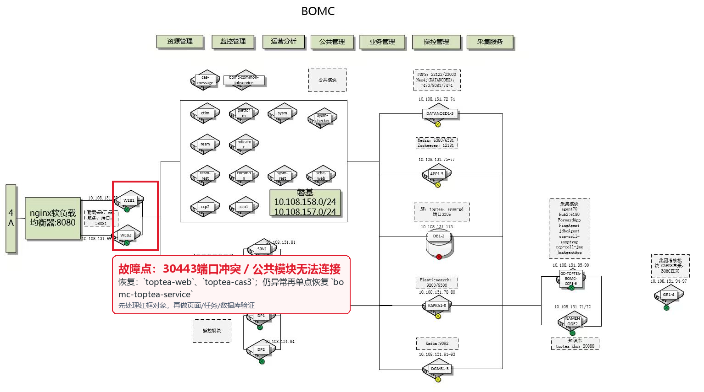

# BOMC - 30443端口冲突与公共模块无法连接 故障处置手册

> **故障分类**: 网络 | **所属域**: B域 | **首次发生**: 2026-01-17 | **累计次数**: 1次
>
> **最后更新**: 2026-01-17 | **数据来源**: BOMC20260-117故障报告2026-01-17
>
> **适用场景**: 30443端口冲突与公共模块无法连接 / BOMC 页面、接口或任务异常
>
> **处置目标**: 确认 30443端口冲突与公共模块无法连接 的主故障对象，完成恢复动作和业务验证。

---

## 故障拓扑



图中标注对象为 BOMC 在 30443端口冲突与公共模块无法连接 场景下的主处理对象和恢复验证对象。处置时先确认主故障点，再扩展到依赖链路和业务验证，避免只根据单个告警对象做局部处理。

关键对象：

- BOMC 集群公共模块、资源模块和 svc 暴露链路：重点确认 30443 端口映射关系。
- ccsec 命名空间 / ccsec-server svc：确认是否抢占 30443 并造成错误转发。
- 10.108.131.68 / 10.108.131.69：WEB 主机，必要时恢复 toptea-web 和 toptea-cas3。
- 10.108.131.75-77：Redis / Zookeeper 伴生排查对象，不能替代主根因判断。

## 故障点标注与恢复对象

红框为本次故障优先处理点；恢复后再按蓝框/依赖链路完成验证。

| 标注 | 故障点/现象 | 优先恢复动作 | 需要重启/执行的服务 |
|---|---|---|---|
| 红框 | WEB/CAS 主机侧 30443 端口或公共模块链路异常 | 先查端口占用、SVC/连接配置和公共模块连通性 | `toptea-web`、`toptea-cas3` |
| 扩展 | 主机侧恢复后 BOMC 入口仍不可用 | 进入 4A/B域磐基界面做服务单点恢复 | `bomc-toptea-service`，必要时核查 `bomc-cas-message` |

> 说明：如果现场服务名、脚本路径与表内名称不一致，以生产主机实际部署和变更审批为准；依赖类故障先恢复依赖，再决定是否重启应用。

## 适用范围与故障判定

### 适用范围

遇到以下任一现象，进入本手册流程处理：

- BOMC 页面无法登录、无告警显示、无数据展示，或提示公共模块无法连接。
- 集群 svc 或端口 30443 映射异常，疑似请求被错误转发。
- Redis / Zookeeper 等伴生异常已处理但页面仍未恢复。

### 判定规则

| 如果看到 | 先做什么 | 判断结论 |
|----------|----------|----------|
| 页面提示公共模块无法连接 | 核查 svc 与 30443 端口占用 | 优先按端口冲突或错误转发处理 |
| Redis / Zookeeper 异常已恢复但页面仍异常 | 继续排查公共模块和端口映射 | 伴生异常不能替代主根因 |
| 确认非 BOMC svc 占用 30443 | 备份后删除或调整冲突 svc | 恢复资源模块和 CAS 后复测 |

## 标准处置流程

1. 记录告警时间、页面现象、公共模块报错和当前影响范围。
2. 核查 Redis / Zookeeper 等伴生异常，但不在伴生异常处停止排查。
3. 执行 svc 与 30443 端口占用检查，确认是否存在非 BOMC 服务抢占。
4. 如确认冲突 svc，先备份定义，再删除或调整冲突服务。
5. 按现场顺序恢复资源模块、CAS 服务和必要的 Web 服务。
6. 验证登录页、公共模块、监控告警和 30443 占用关系均恢复正常。

## 关键检查命令

以下命令已按本故障场景去重整理；每条命令先说明用途，执行前按实际主机、路径、权限和变更流程确认。

### 核查 30443 端口占用

用于确认当前是否存在多个 svc 暴露或抢占 30443 端口，先定位冲突对象，不直接重启应用。

```bash
kubectl get svc -A | grep 30443
```
### 查看疑似冲突服务详情

用于确认 ccsec-server 的命名空间、端口映射和后端指向，删除或调整前必须先核实归属。

```bash
kubectl describe svc ccsec-server -n ccsec
```
### 备份冲突服务定义

用于保留回退依据；只有确认该 svc 为错误转发来源后，才进入删除或调整步骤。

```bash
kubectl get svc ccsec-server -n ccsec -o yaml > /tmp/ccsec-server-svc-backup.yaml
```
### 释放错误端口映射

用于解除非 BOMC 服务对 30443 的占用；执行后必须再次核查端口占用并验证 BOMC 页面。

```bash
kubectl delete svc ccsec-server -n ccsec
kubectl get svc -A | grep 30443
```
### 补充检查 Web/CAS 进程

端口冲突解除后若页面仍未恢复，再检查 BOMC Web/CAS 进程；进程存在但页面打不开时按假活处理。

```bash
ps -ef | grep -E "toptea-web|toptea-cas3" | grep -v grep
```
### 补充清理假活 Web/CAS 进程

仅在端口冲突解除后页面仍打不开、登录超时或服务无响应时执行；先用 ps 定位实际 PID，再结束旧进程并按 Web/CAS 启动顺序恢复。

```bash
kill -9 <toptea-web_PID>
kill -9 <toptea-cas3_PID>
ps -ef | grep -E "toptea-web|toptea-cas3" | grep -v grep
```

## 协同分工与通知口径

### 通知口径

> BOMC 出现 30443端口冲突与公共模块无法连接，当前已按手册确认故障对象为 BOMC 集群公共模块、资源模块和 svc 暴露链路。请对应责任团队优先处理主故障点，运维侧同步保留现场并完成页面、接口、任务和监控恢复验证。

### 谁负责什么

| 角色 | 负责范围 | 处置动作 |
|------|----------|----------|
| 一线运维 | 告警确认、现场操作、恢复验证 | 执行标准处置流程并记录结果 |
| 系统维护 / 厂商 | 应用服务、脚本、配置和程序逻辑 | 恢复服务并定位反复故障根因 |
| DBA / 平台支撑 | 数据库、中间件、主机和网络依赖 | 在扩展验证异常时介入处理 |

## 恢复验证清单

完成恢复动作后，按以下顺序验证：

1. BOMC 关键页面或入口可正常访问。
2. 相关告警已消除或回落到正常阈值。
3. 最近日志不再持续出现同类错误关键字。
4. 服务进程、端口和核心接口均恢复正常。
5. 恢复后至少完成一次关键业务路径验证。

## 根因与预防

### 根因判断

- 直接根因：非 BOMC svc 暴露或抢占 30443 端口，导致 BOMC 请求被错误转发。
- 应用表现：登录、公共模块、监控告警和资源模块访问异常。
- 处置边界：Redis / Zookeeper 超连属于伴生或放大现象，不能替代端口冲突主根因判断。

### 长期预防

- 建立 BOMC 关键 svc 与端口暴露清单，重点纳入 30443。
- 对集群 svc 变更和端口暴露动作增加发布前校验。
- 增加公共模块、资源模块、CAS 链路和端口可达性巡检。

## 历史案例

| 序号 | 发生时间 | 故障现象 | 恢复手段 | 故障原因 | 处理时长 |
|------|----------|----------|----------|----------|----------|
| 1 | 2026-01-17 08:20 | ... | 先完成Redis伴生异常排查，再删除... | 容器安全服务通过 `svc` 暴露 `30443`... | 8h40min |
