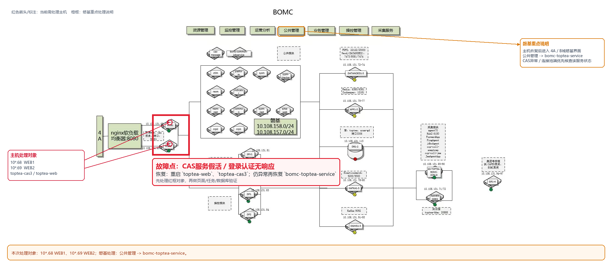

# BOMC - cas服务异常 故障处置手册

> **故障分类**: 应用 | **所属域**: B域 | **首次发生**: 2026-06-19 | **累计次数**: 2次
>
> **最后更新**: 2026-06-20 | **数据来源**: 多域系统故障记录表
>
> **适用场景**: cas服务异常 / BOMC 页面、接口或任务异常
>
> **处置目标**: 确认 cas服务异常 的主故障对象，完成恢复动作和业务验证。

---

## 故障拓扑



图中标注对象为 BOMC 在 cas服务异常 场景下的主处理对象和恢复验证对象。处置时先确认主故障点，再扩展到依赖链路和业务验证，避免只根据单个告警对象做局部处理。

关键对象：

- 10.108.131.68 / 10.108.131.69：WEB 与 CAS 处理主机。
- toptea-web / toptea-cas3：页面访问与认证链路的主恢复对象。
- 4A / B域磐基界面：主机侧恢复后仍异常时执行服务单点恢复。
- bomc-toptea-service / bomc-cas-message：磐基侧扩展验证对象。

## 故障点标注与恢复对象

红框为本次故障优先处理点；恢复后再按蓝框/依赖链路完成验证。

| 标注 | 故障点/现象 | 优先恢复动作 | 需要重启/执行的服务 |
|---|---|---|---|
| 红框 | 10.108.131.68/69 WEB 与 CAS 主机假活、线程阻塞或登录无响应 | 保留必要线程现场后结束旧进程，按先 Web 后 CAS 恢复 | `toptea-web`、`toptea-cas3` |
| 扩展 | 主机侧恢复后 4A/BOMC 入口仍异常 | 通过 4A 进入 B域磐基界面执行单点服务恢复 | `bomc-toptea-service`，必要时核查 `bomc-cas-message` |

> 说明：如果现场服务名、脚本路径与表内名称不一致，以生产主机实际部署和变更审批为准；依赖类故障先恢复依赖，再决定是否重启应用。

## 适用范围与故障判定

### 适用范围

遇到以下任一现象，进入本手册流程处理：

- 2026年6月19日15:13，BOMC系统cas服务出现夯死现象，cas服务进程无响应，web服务关联异常，用户无法正常登录BOMC系统，监控告警页面无法访问，影响运维人员对全网设备的监控和告警处理。经分析，本次故障由代码问题导致cas服务高频故障引发。
- 2026年6月20日10:13分，BOMC系统cas服务夯死，系统不可用。
- BOMC 登录认证失败、CAS 服务无响应或 Web 服务关联异常。
- ps 能查到 toptea-cas3 或 toptea-web，但登录页、监控告警页仍打不开或持续超时。
- 主机侧恢复后仍异常时，需要进入 B域磐基界面做服务单点恢复。

### 判定规则

| 如果看到 | 先做什么 | 判断结论 |
|----------|----------|----------|
| 页面或接口不可用 | 确认进程、端口和最近日志 | 先收敛到应用侧还是依赖侧 |
| 进程存在但页面打不开或请求超时 | 记录 PID，必要时保留线程现场，再 kill 旧进程并重启 | 按服务假活处理，不能只看进程存活 |
| 恢复后仍有告警 | 回查页面、接口、日志和监控 | 确认是否是假恢复或依赖未恢复 |

## 标准处置流程

1. 记录故障时间、页面现象、登录认证状态和受影响入口。
2. 登录 10.108.131.68 / 10.108.131.69，通过 ps 定位 toptea-web 与 toptea-cas3 的 PID。
3. 页面打不开、登录超时或服务无响应时，即使进程仍存在，也按假活处理；先保留必要线程现场，再 kill 旧进程。
4. 确认旧进程已退出后，按先 Web、后 CAS 的顺序启动服务。
5. 重启后验证 BOMC 登录页、监控告警页面和核心入口。
6. 主机侧恢复后仍异常时，通过 4A 进入 B域磐基界面做单点服务恢复。
7. 短时间复发时保留线程、日志和连接池现场，升级开发定位根因。

## 关键检查命令

以下命令已按本故障场景去重整理；每条命令先说明用途，执行前按实际主机、路径、权限和变更流程确认。

### 定位 Web/CAS 进程 PID

页面打不开、登录超时或监控告警页无响应时，ps 结果只用于定位 PID；进程存在不代表服务可用。

```bash
ps -ef | grep -E "toptea-web|toptea-cas3" | grep -v grep
```
### 结束假活 Web/CAS 进程

确认页面不可用或请求持续超时后执行；将占位 PID 替换为上一步查到的实际进程号，两台 WEB 主机需分别处理。

```bash
kill -9 <toptea-web_PID>
kill -9 <toptea-cas3_PID>
ps -ef | grep -E "toptea-web|toptea-cas3" | grep -v grep
```
### 启动 Web 服务

确认旧的 toptea-web 进程已结束后执行；启动完成后继续回查页面入口和日志。

```bash
cd /toptea/apps/toptea-web/bin
./startup.sh
```
### 启动 CAS 服务

确认旧的 toptea-cas3 进程已结束后执行；恢复后必须重新验证登录页和监控告警页。

```bash
cd /toptea/apps/toptea-cas3/bin
./startup.sh
```
### 查看 Web/CAS 日志

用于确认启动后是否仍有认证失败、连接异常、线程阻塞或连续报错。

```bash
tail -n 200 /toptea/apps/toptea-web/logs/catalina.out
tail -n 200 /toptea/apps/toptea-cas3/logs/catalina.out
```
### 采集 CAS 线程现场

短时间复发或 CAS 假死时，在重启前尽量采集线程栈，便于开发定位代码级根因。

```bash
PID=$(pgrep -f "toptea-cas3" | head -n 1)
jstack -l "$PID" > /tmp/bomc_cas_jstack_$(date +%F_%H%M%S).log
```

## 协同分工与通知口径

### 通知口径

> BOMC 出现 cas服务异常，当前已按手册确认故障对象为 10.108.131.68 / 10.108.131.69。请对应责任团队优先处理主故障点，运维侧同步保留现场并完成页面、接口、任务和监控恢复验证。

### 谁负责什么

| 角色 | 负责范围 | 处置动作 |
|------|----------|----------|
| 一线运维 | 告警确认、现场操作、恢复验证 | 执行标准处置流程并记录结果 |
| 系统维护 / 厂商 | 应用服务、脚本、配置和程序逻辑 | 恢复服务并定位反复故障根因 |
| DBA / 平台支撑 | 数据库、中间件、主机和网络依赖 | 在扩展验证异常时介入处理 |

## 恢复验证清单

完成恢复动作后，按以下顺序验证：

1. BOMC 关键页面或入口可正常访问。
2. 相关告警已消除或回落到正常阈值。
3. 最近日志不再持续出现同类错误关键字。
4. 服务进程、端口和核心接口均恢复正常。
5. 恢复后至少完成一次关键业务路径验证。

## 根因与预防

### 根因判断

- 直接根因：BOMC 应用服务出现进程假死、线程池耗尽或认证链路异常。
- 应用表现：页面不可用、登录失败、请求超时或监控告警入口异常。
- 处置边界：先恢复主处理服务，再扩展检查磐基、数据库或其他依赖。

### 长期预防

- 增加进程存活、线程池、响应时间和错误率监控。
- 固化标准恢复顺序和恢复后业务验证清单。
- 对短时间复发问题升级开发或厂商做代码级根因修复。

## 历史案例

| 序号 | 发生时间 | 故障现象 | 恢复手段 | 故障原因 | 处理时长 |
|------|----------|----------|----------|----------|----------|
| 63 | 2026-06-19 15:13 | ... | 重启 `toptea-web`、`toptea-... | ... | 46min |
| 64 | 2026-06-20 10:13 | ... | 重启 `toptea-web`、`toptea-... | ... | 46min |
