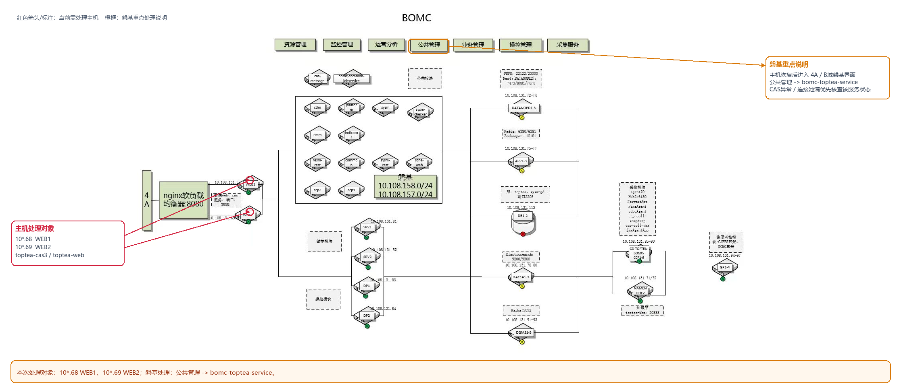

# BOMC 运维总览与故障处理索引

> **所属域**: B域 | **累计故障**: 9次 | **指引数量**: 3篇

## 系统概览

BOMC 通过统一入口提供登录、监控告警和运维操作能力，认证依赖 10*.68、10*.69 两台 Web 主机上的 CAS 与 Web 服务，公共/资源/采集/监控/操控/大屏模块统一在 B域磐基界面管理。

- 服务范围：覆盖 BOMC 登录认证、监控告警、资源管理、采集、操控与大屏展示链路。

### 处理原则

1. 先处理 10*.68 web1、10*.69 web2 主机，再通过 4A 进入 B域磐基界面处理磐基服务模块。
2. 公共模块、资源模块、采集模块、监控模块、操控模块、大屏模块均属于磐基服务，不作为主机 SSH 处理对象。
3. 页面打不开、登录超时或监控告警页无响应时，ps 看到 toptea-web / toptea-cas3 进程存在也按假活处理，先定位 PID，再 kill 旧进程并重启服务。
4. CAS 故障、线程池满等登录类异常恢复后，优先确认 bomc-toptea-service 服务状态。

## 网络拓扑

> 红框为当前故障必须处理的主机；橙框为主机恢复后按需进入 4A 与 B域磐基界面执行的扩展处理区。

## 机器命名规范

目标机器范围为 10*.68 ~ 10*.97；本系统常见登录类故障优先处理两台 Web 主机。

| IP标识 | 规范名称 | 节点说明 | 处理提醒 |
|--------|----------|----------|----------|
| 10*.68 | web1 | CAS / Web 主机 | 登录类故障优先处理节点；页面不可用时 ps 仅用于定位 PID，需清理假活 toptea-cas3、toptea-web 后重启。 |
| 10*.69 | web2 | CAS / Web 主机 | 登录类故障优先处理节点，需与 web1 一并恢复和验证；页面不可用时同样按假活进程清理后重启。 |

## 重点故障点与处置边界

| 故障类型 | 重点位置 | 处置边界 | 验证要求 |
|----------|----------|----------|----------|
| CAS 服务异常 | 10*.68 web1 / 10*.69 web2 | 主机侧查询 toptea-cas3、toptea-web 只用于定位 PID；进程存在但页面不可用时按假活清理，按顺序重启 CAS 与 Web。 | 验证登录页、监控告警页面、CAS/Web 进程和日志恢复正常。 |
| 线程池满 | 10*.68 web1 / 10*.69 web2 + bomc-toptea-service | 主机恢复后如页面仍异常，需通过 4A 登录 B域磐基界面，优先确认 bomc-toptea-service 并执行单点重启。 | 验证登录、首页、告警查询及下游磐基服务状态。 |
| 磐基服务异常扩散 | B域磐基界面服务模块 | 仅在主机侧恢复后仍有资源、采集、监控、操控或大屏异常时，才扩展到模块级单点重启。 | 按模块状态逐项确认服务恢复，不将服务模块误当成主机处理。 |

## 角色分工

### 运维
- 负责范围：Web 主机、登录认证、页面访问、日志验证
- 处置动作：
  1. 优先处理 10*.68 web1、10*.69 web2 上的 toptea-cas3、toptea-web。
  2. 页面打不开但进程仍存在时，按假活进程处理，先 kill 旧进程再启动服务。
  3. 恢复后回查登录页、监控告警页面与核心入口。
  4. 若主机恢复后仍异常，再进入磐基界面扩展处置。

### 磐基平台运维
- 负责范围：B域磐基界面中的服务模块
- 处置动作：
  1. 通过 4A 登录 B域磐基界面。
  2. 优先确认 bomc-toptea-service，必要时再扩展到 bomc-cas-message 及下游模块。
  3. 执行单点重启后配合业务验证。

### 开发
- 负责范围：代码缺陷、线程池与连接池根因修复
- 处置动作：
  1. 定位 CAS 代码缺陷、线程池耗尽和连接池满的真实触发条件。
  2. 评估高并发场景下的线程池、重试与超时配置。
  3. 推动监控与自动恢复能力补齐。

## 运维提醒

- BOMC 登录类高频故障建议统一沉淀为“主机处理 + 磐基界面处理 + 恢复验证”三段式结构。
- BOMC 页面不可用时不能只看进程存活状态；ps 后需要结合页面响应和日志判断是否假活，必要时 kill 旧进程并重启。
- 后续若补齐更多机器映射，可继续向 system_profiles 扩展主机命名表。

## 指引列表

| 序号 | 故障模式 | 分类 | 发生次数 | 最近发生 |
|------|----------|------|----------|----------|
| 1 | 线程池满 | 应用 | 5 | 2026-04-13 |
| 2 | cas服务异常 | 应用 | 2 | 2026-06-20 |
| 3 | 30443端口冲突与公共模块无法连接 | 网络 | 1 | 2026-01-17 |

## 本月高频关注

- 线程池满：累计 5 次，最近发生于 2026-04-13
- cas服务异常：累计 2 次，最近发生于 2026-06-20
- 30443端口冲突与公共模块无法连接：累计 1 次，最近发生于 2026-01-17
