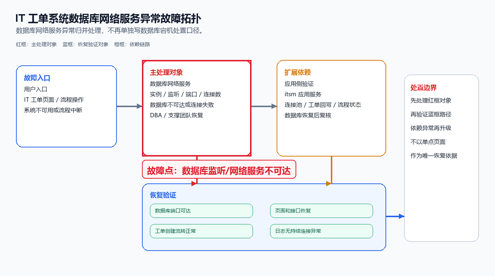

# IT工单系统 - 数据库服务器网络服务异常 故障处置手册

> **故障分类**: 数据库 | **所属域**: B域 | **首次发生**: 2026-06-20 | **累计次数**: 4次
>
> **最后更新**: 2026-06-20 | **数据来源**: 多域系统故障记录表
>
> **适用场景**: 数据库服务器网络服务异常 / IT工单系统 页面、接口或任务异常
>
> **处置目标**: 确认 数据库服务器网络服务异常 的主故障对象，完成恢复动作和业务验证。

---

## 故障拓扑



图中标注对象为 IT工单系统 在 数据库服务器网络服务异常 场景下的主处理对象和恢复验证对象。处置时先确认主故障点，再扩展到依赖链路和业务验证，避免只根据单个告警对象做局部处理。

关键对象：

- IT工单系统 应用节点：确认页面、接口或任务是否受数据库/端口异常影响。
- 数据库或中间件节点：确认实例、监听、端口、连接数和资源水位。
- 业务验证入口：恢复后验证页面、接口、任务结果和数据回写。

## 故障点标注与恢复对象

红框为本次故障优先处理点；恢复后再按蓝框/依赖链路完成验证。

| 标注 | 故障点/现象 | 优先恢复动作 | 需要重启/执行的服务 |
|---|---|---|---|
| 红框 | 数据库实例、监听、端口或连接数异常 | DBA/平台先恢复数据库网络服务和监听 | 数据库监听/网络服务，具体服务名以现场为准 |
| 后续 | 数据库恢复后应用连接池仍不可用 | 刷新连接池或重启应用侧服务 | `itsm` 应用服务 |

> 说明：如果现场服务名、脚本路径与表内名称不一致，以生产主机实际部署和变更审批为准；依赖类故障先恢复依赖，再决定是否重启应用。

## 适用范围与故障判定

### 适用范围

遇到以下任一现象，进入本手册流程处理：

- 2026年6月20日10:13分，IT工单系统出现数据库服务宕机，系统不可用。
- 2026年6月20日11:13分，IT工单系统数据库服务宕机，系统页面无法正常访问，工单流程中断。故障导致所有依赖IT工单系统的业务工单无法创建、流转和处理，影响范围覆盖全部在用IT工单模块。
- 2026年6月20日12:13分，IT工单系统再次出现数据库服务宕机，系统无法正常提供服务。此次为同日第三次数据库服务中断，前两次分别发生于当日10:13至10:59和11:13至12:59。故障影响范围包括IT工单系统的创建、流转、查询等全部业务功能。
- IT工单系统 页面、接口或任务无法正常使用，日志出现数据库或缓存连接异常。
- 数据库、中间件或端口状态异常，业务请求无法正常落库或回写。

### 判定规则

| 如果看到 | 先做什么 | 判断结论 |
|----------|----------|----------|
| 应用日志出现连接失败或端口异常 | 检查数据库/中间件端口和连接数 | 优先按依赖链路异常处理 |
| 实例或缓存恢复但页面仍异常 | 检查连接池和关键交易 | 可能需要应用侧刷新或重启 |
| 数据回写异常 | 核对任务结果和数据库状态 | 确认是否存在残余故障 |

## 标准处置流程

1. 记录告警时间、业务现象、数据库或中间件相关错误关键字。
2. 确认应用进程、数据库/缓存端口、连接数和资源水位。
3. 通知 DBA 或对应支撑团队恢复数据库、中间件或端口服务。
4. 依赖恢复后检查应用连接池、关键交易、任务结果和数据回写。
5. 若页面仍异常，再转入应用进程或厂商侧排查。

## 关键检查命令

以下命令已按本故障场景去重整理；每条命令先说明用途，执行前按实际主机、路径、权限和变更流程确认。

### 查看相关进程

确认相关服务进程是否存活、是否存在重复或僵死进程。

```bash
ps -ef | grep -Ei "it" | grep -v grep
```
### 查看服务状态

若服务由 systemd 管理，可直接确认当前状态与最近报错。

```bash
systemctl status it --no-pager
```
### 查看最近日志

先看近 200 行日志，快速确认报错关键字与时间点。

```bash
tail -n 200 /var/log/it.log
```
### 检查数据库连接与端口

确认数据库实例端口、连接状态和依赖服务是否正常。

```bash
ss -lntp | grep -Ei "db2|mysql|oracle|redis|1521|3306|50000|6379"
```
### 检查资源与磁盘

数据库网络服务异常、连接异常常与资源打满或磁盘异常相关。

```bash
free -h && df -h
```

## 协同分工与通知口径

### 通知口径

> IT工单系统 出现 数据库服务器网络服务异常，当前已按手册确认故障对象为 IT工单系统 应用节点。请对应责任团队优先处理主故障点，运维侧同步保留现场并完成页面、接口、任务和监控恢复验证。

### 谁负责什么

| 角色 | 负责范围 | 处置动作 |
|------|----------|----------|
| 一线运维 | 告警确认、应用侧拨测、业务验证 | 执行端口、日志、页面和任务验证 |
| DBA / 中间件支撑 | 数据库、缓存、监听、连接数和实例状态 | 恢复依赖服务并反馈链路状态 |
| 开发 / 厂商 | 恢复后仍异常的应用链路 | 排查连接池、重试、配置和接口耗时 |

## 恢复验证清单

完成恢复动作后，按以下顺序验证：

1. IT工单系统 关键页面或入口可正常访问。
2. 相关告警已消除或回落到正常阈值。
3. 最近日志不再持续出现同类错误关键字。
4. 数据库或中间件端口、连接数和实例状态恢复正常。
5. 关键交易、任务结果和数据回写正常。

## 根因与预防

### 根因判断

- 直接根因：数据库、缓存、中间件或端口服务异常，导致应用连接和数据回写失败。
- 应用表现：页面、接口或任务异常，日志集中出现连接失败、超时或实例不可达。
- 处置边界：依赖恢复前不将应用表现误判为单纯页面或 Tomcat 故障。

### 长期预防

- 建立实例、端口、连接数、连接池和关键 SQL 的组合监控。
- 固化数据库/缓存异常后的应用侧恢复验证流程。
- 对短时间复发的依赖异常输出专项根因和容量治理动作。

## 历史案例

| 序号 | 发生时间 | 故障现象 | 恢复手段 | 故障原因 | 处理时长 |
|------|----------|----------|----------|----------|----------|
| 67 | 2026-06-20 10:13 | IT工单系统数据库服务宕机，系统不可用 | 重启数据库主机服务，恢复数据库实例运行 | 数据库实例进程资源耗尽并触发 OOM，应用连接治理不足 | 46min |
| 71 | 2026-06-20 12:13 | 同日第三次数据库服务中断，创建、流转、查询全部受影响 | 重启数据库主机服务 | 原始记录 system 字段异常，已归并到... | 106min |
