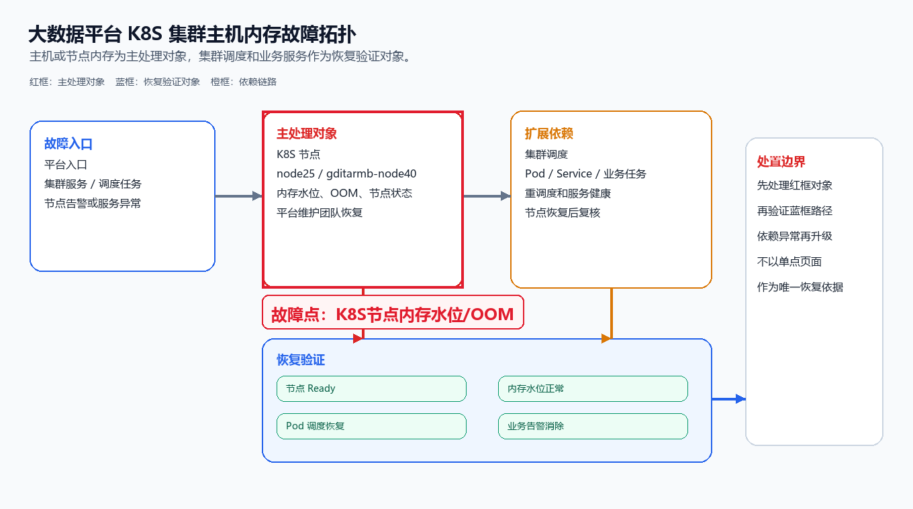

# 大数据平台K8S集群 - 主机内存故障 故障处置手册

> **故障分类**: 其他 | **所属域**: B域 | **首次发生**: 2026-05-06 | **累计次数**: 2次
>
> **最后更新**: 2026-06-02 | **数据来源**: 多域系统故障记录表
>
> **适用场景**: 主机内存故障 / 大数据平台K8S集群 页面、接口或任务异常
>
> **处置目标**: 确认 主机内存故障 的主故障对象，完成恢复动作和业务验证。

---

## 故障拓扑



图中标注对象为 大数据平台K8S集群 在 主机内存故障 场景下的主处理对象和恢复验证对象。处置时先确认主故障点，再扩展到依赖链路和业务验证，避免只根据单个告警对象做局部处理。

关键对象：

- 大数据平台K8S集群 故障节点：确认主机、容器或集群节点资源状态。
- 平台维护团队：负责主机、节点、内存或调度层恢复。
- 业务验证入口：恢复后验证服务调度、页面、接口和告警消除。

## 故障点标注与恢复对象

红框为本次故障优先处理点；恢复后再按蓝框/依赖链路完成验证。

| 标注 | 故障点/现象 | 优先恢复动作 | 需要重启/执行的服务 |
|---|---|---|---|
| 红框 | K8S 节点内存过高、OOM 或节点状态异常 | 先释放内存、驱逐或重启异常 Pod/容器 | 受影响 Pod/容器；必要时处理 kubelet/container runtime |
| 升级 | 节点级故障或多 Pod 反复异常 | 按平台变更流程隔离/重启节点 | 节点重启需平台维护确认 |

> 说明：如果现场服务名、脚本路径与表内名称不一致，以生产主机实际部署和变更审批为准；依赖类故障先恢复依赖，再决定是否重启应用。

## 适用范围与故障判定

### 适用范围

遇到以下任一现象，进入本手册流程处理：

- node25节点主机内存故障
- gditarmb-node40节点主机内存故障
- 大数据平台K8S集群 出现与 主机内存故障 相关的重复性故障现象。
- 页面、接口、任务或日志表现异常，需要先确认影响范围再执行恢复。
- 恢复后必须验证业务入口、关键日志和监控告警均已恢复。

### 判定规则

| 如果看到 | 先做什么 | 判断结论 |
|----------|----------|----------|
| 服务不可用且主机响应异常 | 保留资源、内核、进程现场 | 优先按主机层故障处理 |
| 主机可登录但进程假活 | 查资源、D 状态进程和日志 | 确认是否需要维护团队重启 |
| 主机恢复后业务仍异常 | 复核服务进程、端口和页面 | 转入应用链路恢复验证 |

## 标准处置流程

1. 记录告警时间、故障入口、受影响业务和当前监控状态。
2. 确认服务进程、端口监听、资源水位和最近日志关键字。
3. 按故障边界通知运维、厂商、开发或 DBA 介入处理。
4. 执行恢复动作后回查页面、接口、任务和日志。
5. 若短时间复发，保留现场并升级根因分析，不只重复重启。

## 关键检查命令

以下命令已按本故障场景去重整理；每条命令先说明用途，执行前按实际主机、路径、权限和变更流程确认。

### 查看相关进程

确认相关服务进程是否存活、是否存在重复或僵死进程。

```bash
ps -ef | grep -Ei "k8s" | grep -v grep
```
### 查看服务状态

若服务由 systemd 管理，可直接确认当前状态与最近报错。

```bash
systemctl status k8s --no-pager
```
### 查看最近日志

先看近 200 行日志，快速确认报错关键字与时间点。

```bash
tail -n 200 /var/log/k8s.log
```
### 查看系统资源快照

先建立现场快照，便于判断是服务问题还是环境问题。

```bash
uptime && free -h && df -h
```
### 检查关键日志关键字

按实际日志路径替换，快速搜集错误、超时、异常退出信息。

```bash
grep -Ei "error|exception|timeout|oom|fail" /var/log/k8s.log | tail -n 50
```

## 协同分工与通知口径

### 通知口径

> 大数据平台K8S集群 出现 主机内存故障，当前已按手册确认故障对象为 大数据平台K8S集群 故障节点。请对应责任团队优先处理主故障点，运维侧同步保留现场并完成页面、接口、任务和监控恢复验证。

### 谁负责什么

| 角色 | 负责范围 | 处置动作 |
|------|----------|----------|
| 一线运维 | 告警确认、现场操作、恢复验证 | 执行标准处置流程并记录结果 |
| 系统维护 / 厂商 | 应用服务、脚本、配置和程序逻辑 | 恢复服务并定位反复故障根因 |
| DBA / 平台支撑 | 数据库、中间件、主机和网络依赖 | 在扩展验证异常时介入处理 |

## 恢复验证清单

完成恢复动作后，按以下顺序验证：

1. 大数据平台K8S集群 关键页面或入口可正常访问。
2. 相关告警已消除或回落到正常阈值。
3. 最近日志不再持续出现同类错误关键字。
4. 服务进程、端口和核心接口均恢复正常。
5. 恢复后至少完成一次关键业务路径验证。

## 根因与预防

### 根因判断

- 直接根因：主机内存故障 导致 大数据平台K8S集群 关键业务路径异常。
- 应用表现：页面、接口、任务或日志链路异常，需要结合现场进一步定位。
- 处置边界：先按本手册主故障点恢复，再扩展检查依赖链路。

### 长期预防

- 补充进程、端口、错误率、接口耗时和关键日志监控。
- 固化标准恢复动作、升级边界和恢复验证要求。
- 对重复故障输出根因修复计划，不只依赖人工重启。

## 历史案例

| 序号 | 发生时间 | 故障现象 | 恢复手段 | 故障原因 | 处理时长 |
|------|----------|----------|----------|----------|----------|
| 54 | 2026-05-06 15:20 | node25节点主机内存故障 | ... | 主机内存故障 | 113min |
| 62 | 2026-06-02 09:00 | gditarmb-node40节点主机内存故障 | ... | 主机内存故障 | 182min |
