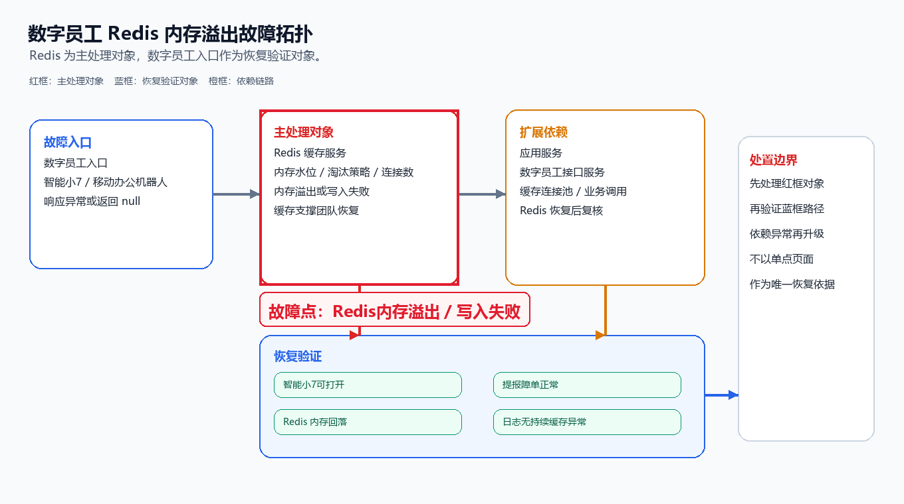

# 数字员工 - redis内存溢出 故障处置手册

> **故障分类**: 数据库 | **所属域**: M域 | **首次发生**: 2026-02-23 | **累计次数**: 3次
>
> **最后更新**: 2026-03-17 | **数据来源**: 多域系统故障记录表
>
> **适用场景**: redis内存溢出 / 数字员工 页面、接口或任务异常
>
> **处置目标**: 确认 redis内存溢出 的主故障对象，完成恢复动作和业务验证。

---

## 故障拓扑



图中标注对象为 数字员工 在 redis内存溢出 场景下的主处理对象和恢复验证对象。处置时先确认主故障点，再扩展到依赖链路和业务验证，避免只根据单个告警对象做局部处理。

关键对象：

- 数字员工 应用节点：确认页面、接口或任务是否受数据库/端口异常影响。
- 数据库或中间件节点：确认实例、监听、端口、连接数和资源水位。
- 业务验证入口：恢复后验证页面、接口、任务结果和数据回写。

## 故障点标注与恢复对象

红框为本次故障优先处理点；恢复后再按蓝框/依赖链路完成验证。

| 标注 | 故障点/现象 | 优先恢复动作 | 需要重启/执行的服务 |
|---|---|---|---|
| 红框 | Redis 内存水位、淘汰策略、连接数或写入失败 | 先恢复 Redis 容量和服务状态 | `redis` 服务/集群节点，具体实例以现场为准 |
| 蓝框 | 数字员工接口依赖 Redis 后仍异常 | Redis 恢复后再验证接口连接池和业务调用 | 数字员工接口服务，仅在连接池卡住时重启 |

> 说明：如果现场服务名、脚本路径与表内名称不一致，以生产主机实际部署和变更审批为准；依赖类故障先恢复依赖，再决定是否重启应用。

## 适用范围与故障判定

### 适用范围

遇到以下任一现象，进入本手册流程处理：

- 智能小7打开异常
- 移动办公机器人响应返回值异常null
- 数字员工 页面、接口或任务无法正常使用，日志出现数据库或缓存连接异常。
- 数据库、中间件或端口状态异常，业务请求无法正常落库或回写。
- 恢复后仍需验证连接池、关键交易、数据回写和日志错误是否消除。

### 判定规则

| 如果看到 | 先做什么 | 判断结论 |
|----------|----------|----------|
| 应用日志出现连接失败或端口异常 | 检查数据库/中间件端口和连接数 | 优先按依赖链路异常处理 |
| 实例或缓存恢复但页面仍异常 | 检查连接池和关键交易 | 可能需要应用侧刷新或重启 |
| 数据回写异常 | 核对任务结果和数据库状态 | 确认是否存在残余故障 |

## 标准处置流程

1. 记录告警时间、业务现象、数据库或中间件相关错误关键字。
2. 确认应用进程、数据库/缓存端口、连接数和资源水位。
3. 通知 DBA 或对应支撑团队恢复数据库、中间件或端口服务。
4. 依赖恢复后检查应用连接池、关键交易、任务结果和数据回写。
5. 若页面仍异常，再转入应用进程或厂商侧排查。

## 关键检查命令

以下命令已按本故障场景去重整理；每条命令先说明用途，执行前按实际主机、路径、权限和变更流程确认。

### 查看相关进程

确认相关服务进程是否存活、是否存在重复或僵死进程。

```bash
ps -ef | grep -Ei "redis" | grep -v grep
```
### 查看服务状态

若服务由 systemd 管理，可直接确认当前状态与最近报错。

```bash
systemctl status redis --no-pager
```
### 查看最近日志

先看近 200 行日志，快速确认报错关键字与时间点。

```bash
tail -n 200 /var/log/redis.log
```
### 检查数据库连接与端口

确认数据库实例端口、连接状态和依赖服务是否正常。

```bash
ss -lntp | grep -Ei "db2|mysql|oracle|redis|1521|3306|50000|6379"
```
### 检查资源与磁盘

数据库网络服务异常、连接异常常与资源打满或磁盘异常相关。

```bash
free -h && df -h
```

## 协同分工与通知口径

### 通知口径

> 数字员工 出现 redis内存溢出，当前已按手册确认故障对象为 数字员工 应用节点。请对应责任团队优先处理主故障点，运维侧同步保留现场并完成页面、接口、任务和监控恢复验证。

### 谁负责什么

| 角色 | 负责范围 | 处置动作 |
|------|----------|----------|
| 一线运维 | 告警确认、应用侧拨测、业务验证 | 执行端口、日志、页面和任务验证 |
| DBA / 中间件支撑 | 数据库、缓存、监听、连接数和实例状态 | 恢复依赖服务并反馈链路状态 |
| 开发 / 厂商 | 恢复后仍异常的应用链路 | 排查连接池、重试、配置和接口耗时 |

## 恢复验证清单

完成恢复动作后，按以下顺序验证：

1. 数字员工 关键页面或入口可正常访问。
2. 相关告警已消除或回落到正常阈值。
3. 最近日志不再持续出现同类错误关键字。
4. 数据库或中间件端口、连接数和实例状态恢复正常。
5. 关键交易、任务结果和数据回写正常。

## 根因与预防

### 根因判断

- 直接根因：数据库、缓存、中间件或端口服务异常，导致应用连接和数据回写失败。
- 应用表现：页面、接口或任务异常，日志集中出现连接失败、超时或实例不可达。
- 处置边界：依赖恢复前不将应用表现误判为单纯页面或 Tomcat 故障。

### 长期预防

- 建立实例、端口、连接数、连接池和关键 SQL 的组合监控。
- 固化数据库/缓存异常后的应用侧恢复验证流程。
- 对短时间复发的依赖异常输出专项根因和容量治理动作。

## 历史案例

| 序号 | 发生时间 | 故障现象 | 恢复手段 | 故障原因 | 处理时长 |
|------|----------|----------|----------|----------|----------|
| 17 | 2026-02-23 21:05 | 智能小7打开异常 | 调整redis内存空间 | redis内存溢出导致 | 67min |
| 30 | 2026-03-17 08:01 | 移动办公机器人响应返回值异常null | 清理redis过期缓存token腾出内存空间 | redis内存溢出导致 | 33min |
