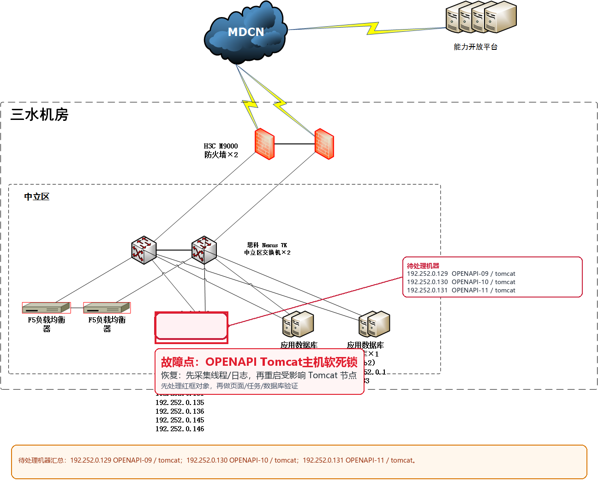

# OPENAPI - 主机软死锁 故障处置手册

> **故障分类**: 主机 | **所属域**: 经分域 | **首次发生**: 2026-05-22 | **累计次数**: 3次
>
> **最后更新**: 2026-06-18 | **数据来源**: 多域系统故障记录表
>
> **适用场景**: 主机软死锁 / OPENAPI 页面、接口或任务异常
>
> **处置目标**: 确认 主机软死锁 的主故障对象，完成恢复动作和业务验证。

---

## 故障拓扑



图中标注对象为 OPENAPI 在 主机软死锁 场景下的主处理对象和恢复验证对象。处置时先确认主故障点，再扩展到依赖链路和业务验证，避免只根据单个告警对象做局部处理。

关键对象：

- OPENAPI-09 / OPENAPI-10 / OPENAPI-11：Tomcat 应用节点，主机软死锁主处理对象。
- OPENAPI-01：Nginx / F5 拨测侧对象，恢复后验证入口转发。
- OPENAPI-12：Redis 节点，恢复后作为缓存链路补充验证。
- 卓望维护组：负责主机重启与主机层恢复反馈。

## 故障点标注与恢复对象

红框为本次故障优先处理点；恢复后再按蓝框/依赖链路完成验证。

| 标注 | 故障点/现象 | 优先恢复动作 | 需要重启/执行的服务 |
|---|---|---|---|
| 红框 | OPENAPI-09/10/11 Tomcat 节点假活或主机软死锁 | 采集线程、CPU、日志后重启受影响节点 | OPENAPI Tomcat/应用服务 |
| 蓝框 | F5、Nginx、DB2、Redis 访问验证 | Tomcat 恢复后验证入口、接口和依赖链路 | 依赖服务不作为默认重启对象 |

> 说明：如果现场服务名、脚本路径与表内名称不一致，以生产主机实际部署和变更审批为准；依赖类故障先恢复依赖，再决定是否重启应用。

## 适用范围与故障判定

### 适用范围

遇到以下任一现象，进入本手册流程处理：

- 主机出现软死锁
- 2026年6月18日13:20，OPENAPI系统主机再次出现软死锁现象，系统页面无法访问，API接口调用全部超时无响应，所有依赖OPENAPI接口的上游业务系统数据查询功能中断。本次故障与当日11:20分发生的故障属同类型问题，均为主机软死锁导致。服务台接到用户反馈后上报多域维护组，经排查确认主机软死锁，通知卓望团队协助重启主机恢复服务。
- OPENAPI 服务不可用，疑似主机、节点、内存或操作系统层异常。
- 进程可能仍存在但无法响应，需先保留主机现场再恢复。
- 恢复后必须验证主机资源、服务进程、页面和接口链路。

### 判定规则

| 如果看到 | 先做什么 | 判断结论 |
|----------|----------|----------|
| 服务不可用且主机响应异常 | 保留资源、内核、进程现场 | 优先按主机层故障处理 |
| 主机可登录但进程假活 | 查资源、D 状态进程和日志 | 确认是否需要维护团队重启 |
| 主机恢复后业务仍异常 | 复核服务进程、端口和页面 | 转入应用链路恢复验证 |

## 标准处置流程

1. 记录告警时间、不可访问入口、API 超时范围和当前主机状态。
2. 优先保留主机现场，包括 load、CPU、内存、IO wait、D 状态进程和内核日志。
3. 通知卓望维护组处理 OPENAPI-09 / 10 / 11 主机软死锁并执行主机恢复。
4. 主机恢复后检查 Tomcat 进程，必要时清理异常进程并启动服务。
5. 验证 OPENAPI 页面、关键接口、ESBURL 调用日志和入口转发。
6. 同日复发时升级主机稳定性、存储和单机依赖治理。

## 关键检查命令

以下命令已按本故障场景去重整理；每条命令先说明用途，执行前按实际主机、路径、权限和变更流程确认。

### 保留主机资源现场

用于确认主机是否存在负载、内存、磁盘或 IO wait 异常，优先在重启前采集。

```bash
uptime
free -h
df -h
top -b -n 1 | head -n 30
```
### 查看内核和异常进程

用于判断是否存在软死锁、D 状态进程、OOM 或底层存储异常。

```bash
dmesg | tail -n 100
ps -eo pid,stat,comm,wchan:32 --sort=stat | grep -E " D|tomcat|java" | head -n 50
```
### 检查 Tomcat 进程

主机恢复后执行，确认 Tomcat 是否仍在、是否需要清理异常进程并启动服务。

```bash
ps -ef | grep tomcat | grep -v grep
```
### 查看 OPENAPI 应用日志

用于确认主机恢复后是否仍有接口超时、连接失败或外部接口调用异常。

```bash
tail -n 200 /opt/tomcat/apache-tomcat-7.0.77/bin/logs/catalina.$(date +%Y-%m-%d).log
```

## 协同分工与通知口径

### 通知口径

> OPENAPI 出现 主机软死锁，当前已按手册确认故障对象为 OPENAPI-09 / OPENAPI-10 / OPENAPI-11。请对应责任团队优先处理主故障点，运维侧同步保留现场并完成页面、接口、任务和监控恢复验证。

### 谁负责什么

| 角色 | 负责范围 | 处置动作 |
|------|----------|----------|
| 一线运维 | 告警确认、现场采集、业务验证 | 保留资源和日志现场，跟进恢复验证 |
| 主机 / 平台维护 | 主机、节点、内存、系统或集群调度 | 执行主机或节点恢复并反馈状态 |
| 开发 / 厂商 | 恢复后仍异常的应用链路 | 排查服务进程、任务和接口异常 |

## 恢复验证清单

完成恢复动作后，按以下顺序验证：

1. OPENAPI 关键页面或入口可正常访问。
2. 相关告警已消除或回落到正常阈值。
3. 最近日志不再持续出现同类错误关键字。
4. 主机或节点资源水位恢复正常，无持续 D 状态、OOM 或内核异常。
5. 服务进程、端口监听、调度状态和业务接口均恢复。

## 根因与预防

### 根因判断

- 直接根因：主机、节点、内存或系统层异常影响服务运行。
- 应用表现：页面、接口、任务或容器调度异常，进程可能存在但无法正常响应。
- 处置边界：主机恢复后仍需回查应用进程、端口和业务入口。

### 长期预防

- 建立主机资源、内核告警、节点健康和服务心跳监控。
- 固化主机现场保留和恢复后验证流程。
- 对反复主机故障推动冗余、迁移或硬件/系统治理。

## 历史案例

| 序号 | 发生时间 | 故障现象 | 恢复手段 | 故障原因 | 处理时长 |
|------|----------|----------|----------|----------|----------|
| 57 | 2026-05-22 11:45 | 主机出现软死锁 | 重启主机 | 底层存储异常导致主机软死锁 | 68min |
| 68 | 2026-06-18 13:20 | OPENAPI 页面不可访问，API 全部超时，确认主机软死锁 | 通知卓望团队重启主机 | 主机层面软死锁，缺少自动检测恢复，单机无冗余 | 36min |
