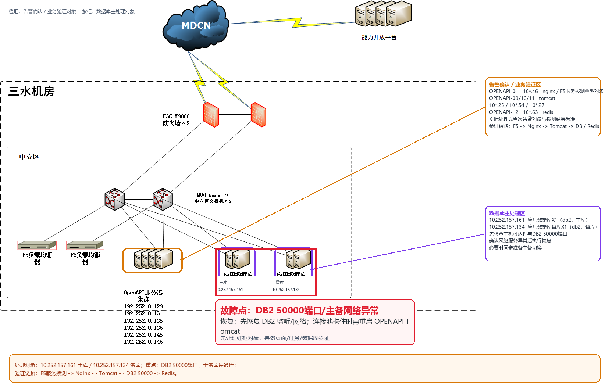

# OPENAPI - 数据库服务器网络服务异常 故障处置手册

> **故障分类**: 数据库 | **所属域**: 经分域 | **首次发生**: 2026-04-01 | **累计次数**: 6次
>
> **最后更新**: 2026-04-30 | **数据来源**: 多域系统故障记录表 + 2026-04-01 专项复盘
>
> **适用场景**: OpenAPI 页面或接口不可用 / 数据库 50000 端口异常 / 能运接口成功率异常 / 信令接口拨测日志异常 / 原数据库类口径故障
>
> **处置目标**: 通过应用节点、数据库主备、DB2 监听和 `50000` 端口检查，确认是否为数据库主机网络服务异常，并完成 OpenAPI 业务恢复验证。

---

## 故障拓扑



图中橙框为 OpenAPI 告警与业务验证对象，紫框为数据库主备处理对象。处置时优先核对数据库主机网络服务、DB2 监听和 `50000` 端口，不应只依据告警对象名称定位单台 OpenAPI 机器。

关键对象：

- `10.252.157.161`：当前主库，重点确认主机可达性、DB2 监听和 `50000` 端口。
- `10.252.157.134`：当前备库，主库异常时同步确认可达性。
- `OPENAPI-09 / 10 / 11`：Tomcat 应用节点，用于执行数据库拨测、日志检查和接口验证。
- `OPENAPI-01`：Nginx / F5 拨测侧典型对象；告警显示为 01 时，不代表只处理 01。
- `OPENAPI-12`：Redis 节点，数据库恢复后作为缓存链路补充验证。

历史记录中标记为数据库类口径的 OPENAPI 故障统一归并到本手册，不再单独维护独立数据库类指引。

## 故障点标注与恢复对象

红框为本次故障优先处理点；恢复后再按蓝框/依赖链路完成验证。

| 标注 | 故障点/现象 | 优先恢复动作 | 需要重启/执行的服务 |
|---|---|---|---|
| 红框 | 10.252.157.161 主库、10.252.157.134 备库或 DB2 50000 端口异常 | 先恢复 DB2 监听、主备网络连通和数据库状态 | DB2 监听/网络服务，具体服务名以现场为准 |
| 后续 | DB2 恢复后 OPENAPI 仍连接失败 | 刷新连接池或重启受影响 Tomcat 节点 | OPENAPI Tomcat/应用服务 |

> 说明：如果现场服务名、脚本路径与表内名称不一致，以生产主机实际部署和变更审批为准；依赖类故障先恢复依赖，再决定是否重启应用。

## 适用范围与故障判定

### 适用范围

遇到以下任一现象，进入本手册流程处理：

- `OpenAPI` 页面无法访问，或接口调用集中超时。
- 数据库 `50000` 端口状态返回 `False`，例如 `XJ_大数据_OpenAPI_数据库_50000端口状态_OPENAPI-01`。
- 能运 OpenAPI 接口成功率异常，尤其低于 `80%`。
- 信令接口拨测日志值超过 `2000`，例如 `XJ_openapi_信令接口拨测-实时接口*状态_27`。
- 应用日志集中出现 `connection`、`timeout`、`datasource`、`db2`、`sql`、`50000` 等数据库相关报错。

### 判定规则

| 如果看到 | 先做什么 | 判断结论 |
|----------|----------|----------|
| 多台 OpenAPI 节点都报数据库 `50000` 不通 | 登录 `OPENAPI-09 / 10 / 11` 任一应用节点拨测主备库 | 优先按数据库侧链路异常处理 |
| 页面不可用但 Tomcat 进程仍在 | 查应用日志是否集中报数据库连接异常 | 不要先重启 Tomcat，先确认数据库链路 |
| 信令接口日志值超过 `2000` | 查数据库端口和 Tomcat 日志 | 多数情况下是数据库不可达拖慢接口 |
| 数据库端口恢复 `OK` 但页面仍异常 | 查连接池、日志和接口返回 | 可能需要应用侧刷新连接池或滚动恢复 |

## 标准处置流程

1. 记录告警时间、告警对象、成功率或当前值、受影响业务。
2. 登录 `OPENAPI-09 / OPENAPI-10 / OPENAPI-11` 任一应用节点。
3. 对照故障拓扑确认 OpenAPI 告警对象、应用节点和数据库主备关系。
4. 拨测数据库主备和 `50000` 端口。
5. 查询信令接口耗时和 Tomcat 应用日志，确认是否存在数据库连接异常。
6. 若数据库主备不可达或 `50000` 返回 `False`，通知亚信数据库团队处理数据库主机网络服务和 DB2 监听。
7. 数据库恢复后，按恢复验证清单逐项确认，不以单一页面打开作为恢复依据。

## 关键检查命令

### 1. 拨测数据库主备和 50000 端口

在 `OPENAPI-09 / OPENAPI-10 / OPENAPI-11` 任一应用节点执行：

```bash
ping 10.252.157.161
ping 10.252.157.134
for ip in 10.252.157.161 10.252.157.134; do
  (timeout 1 bash -c "cat < /dev/null > /dev/tcp/$ip/50000" >/dev/null 2>&1) \
    && echo "$ip OK" || echo "$ip False"
done
```

- 返回 `OK`：数据库端口可达，继续查接口耗时和应用日志。
- 返回 `False`：数据库端口不可达，优先通知数据库团队，不要把问题扩大成 Tomcat 故障。
- 主备都不可达，或多台应用节点都返回 `False`：按数据库主机网络服务异常升级处理。

### 2. 查信令接口拨测日志

用于判断外部接口耗时是否持续超过阈值，并结合数据库端口结果确认是否由数据库不可达引起。

```bash
cd /opt/tomcat/apache-tomcat-7.0.77/bin/logs
LOG="catalina.$(date +%Y-%m-%d).log"
PATTERN="com.gmcc.realUsrAreaInfo;ESBURL"
tail -n500 "$LOG" \
  | grep "$PATTERN" \
  | grep -v 'start httpclient.execute....' \
  | awk -F ':' '{sub(/ms$/," ",$NF);print $NF}'
```

- 持续超过 `2000`：按接口异常继续跟踪，并结合数据库端口结果判断是否由数据库不可达引起。
- 恢复后应回落到 `0-2000` 区间。

### 3. 查 Tomcat 进程和数据库报错

用于确认 Tomcat 是否仍在运行，并快速筛选连接失败、超时、DB2、SQL 和 50000 端口相关错误。

```bash
ps -ef | grep tomcat | grep -v grep
cd /opt/tomcat/apache-tomcat-7.0.77/bin/logs
tail -n200 catalina.$(date +%Y-%m-%d).log \
  | grep -Ei "connection|timeout|datasource|db2|sql|50000|realUsrAreaInfo"
```

如果日志集中出现数据库连接异常、配置读取失败、日志写入失败，说明应用侧表现只是结果，主处理对象仍是数据库主机网络服务或 DB2 监听。

## 协同分工与通知口径

### 通知口径

可以直接按下面口径同步：

> OPENAPI 出现页面或接口异常，应用节点拨测数据库主备 `10.252.157.161 / 10.252.157.134` 及 `50000` 端口异常。请亚信数据库团队优先检查数据库主机网络服务、DB2 监听和主备状态。运维侧同步观察 OpenAPI 接口成功率、信令接口耗时和业务恢复情况。

### 谁负责什么

| 角色 | 负责范围 | 处置动作 |
|------|----------|----------|
| 一线运维 | 告警确认、应用节点拨测、业务验证 | 执行端口拨测、日志检查和恢复验证 |
| DBA / 亚信数据库团队 | 数据库主机网络服务、DB2 监听、主备状态 | 恢复数据库主机网络服务或 DB2 监听，反馈数据库链路状态 |
| 开发 / 厂商 | 数据库恢复后仍异常的应用链路 | 排查连接池、重试、配置读取、写日志和接口耗时问题 |

## 恢复验证清单

数据库团队反馈恢复后，按下面顺序验证：

1. `10.252.157.161 / 10.252.157.134` 至少一侧数据库链路稳定可达。
2. 数据库 `50000` 端口拨测返回 `OK`。
3. 信令接口拨测日志值回落到 `0-2000`。
4. 能运 OpenAPI 接口成功率恢复正常，且不低于 `80%`。
5. `网格通`、`和商汇断卡`、`实时销量`、`全域旅游` 等关键业务恢复。
6. OpenAPI 日志不再持续出现数据库连接异常、配置读取失败或日志写入失败。
7. 若页面仍不可用，再通知开发或厂商检查连接池和应用进程，不要重复通知数据库团队做同一动作。

## 根因与预防

### 根因判断

- `直接根因`：数据库服务器网络服务异常，导致主库或备库在故障期间不可达。
- `应用表现`：OpenAPI 页面或接口异常，日志集中出现数据库连接、配置读取或写日志报错。
- `结论`：此类故障归类为数据库服务器网络服务异常，不再单独维护独立数据库类处置路径。

### 长期预防

- 增加数据库主机 `ping`、数据库端口可达性、DB2 监听与实例状态的组合监控。
- 对 OpenAPI 增加 HTTP 成功率、接口调用成功率、数据库连接异常次数、`50000` 端口状态和信令接口拨测日志值的分钟级监控。
- 固化数据库主备切换演练流程，至少按报告要求在月内完成一次应急演练。
- 故障恢复后增加数据波动复核步骤，避免把业务正常波动误判为残余故障。

## 历史案例

> 本手册只保留首发代表案例和最近复发案例；完整流水记录以月度故障表为准。2026-04-30 当天曾出现 4 次短时复发，均按数据库网络服务异常归并处理。

| 序号 | 发生时间 | 故障现象 | 恢复手段 | 故障原因 | 处理时长 |
|------|----------|----------|----------|----------|----------|
| 23 | 2026-04-01 08:58 | 页面无法访问 | 数据库组处理 | 数据库网络服务异常 | 35min |
| 50 | 2026-04-30 15:34 | 页面无法访问 | 数据库组处理 | 数据库网络服务异常 | 5min |
