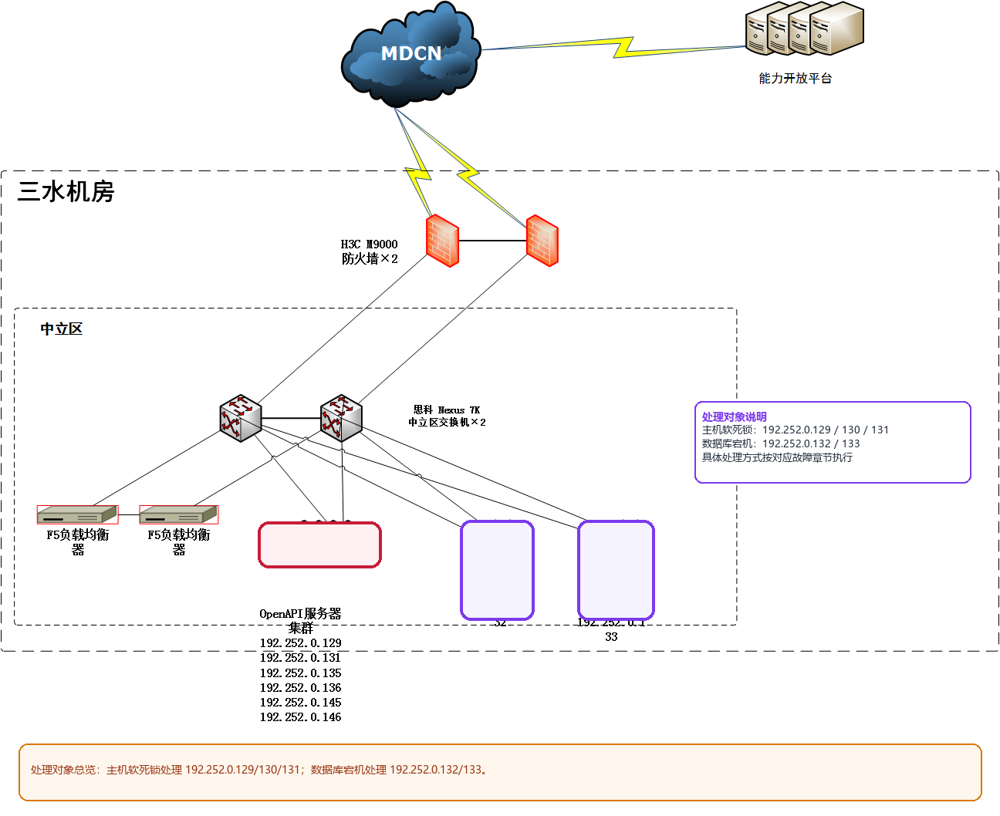

# OPENAPI 运维总览与故障处理索引

> **所属域**: 经分域 | **累计故障**: 11次 | **指引数量**: 2篇

## 系统概览

OPENAPI 提供统一接口访问能力，入口经 Nginx 转发至 Tomcat 应用节点，依赖 DB2 数据库、Redis 缓存和外部 ESBURL 接口链路。

- 服务范围：覆盖 OPENAPI 入口代理、Tomcat 应用、DB2 数据库依赖、Redis 缓存与外部接口调用链路。

### 处理原则

1. 主机软死锁与数据库类故障按不同入口处理；OPENAPI 数据库类故障统一归入数据库服务器网络服务异常，不再保留独立指引。
2. OPENAPI-09 ~ OPENAPI-11 承载 Tomcat，应在主机恢复后复核进程、日志、页面和接口。
3. DB2 数据库网络服务与实例由亚信团队恢复，主机软死锁由卓望维护组处理，运维侧负责入口、应用和接口链路验证。

## 网络拓扑

> 红框为主机软死锁处理区，紫框为数据库服务器网络服务异常处理区；按故障类型选择对应框选对象处理，避免混用。

## 机器命名规范

统一按 10* 后两位映射 OPENAPI 机器名称，故障沟通、日志定位和升级时优先使用规范名称。

| IP标识 | 规范名称 | 节点说明 | 处理提醒 |
|--------|----------|----------|----------|
| 10*.46 | OPENAPI-01 | Nginx 节点 | 入口代理/流量转发节点，故障时纳入入口链路验证。 |
| 10*.25 | OPENAPI-09 | Tomcat 应用节点 | 主机软死锁重点处理节点。 |
| 10*.54 | OPENAPI-10 | Tomcat 应用节点 | 主机软死锁重点处理节点。 |
| 10*.27 | OPENAPI-11 | Tomcat 应用节点 | 主机软死锁重点处理节点。 |
| 10*.63 | OPENAPI-12 | Redis 节点 | 缓存依赖节点，恢复后纳入链路验证。 |

## 重点故障点与处置边界

| 故障类型 | 重点位置 | 处置边界 | 验证要求 |
|----------|----------|----------|----------|
| 主机软死锁 | OPENAPI-09 / OPENAPI-10 / OPENAPI-11 | 主机故障，等待卓望维护组重启主机；主机可操作时再执行 Tomcat 进程清理、复核和启动。 | 验证 Tomcat 进程、OPENAPI 页面、关键接口和 ESBURL 调用日志。 |
| 数据库服务器网络服务异常 | DB2 数据库主机 | 数据库主机网络服务、DB2 监听或 50000 端口异常时，等待亚信团队恢复数据库侧链路；数据库恢复前不将应用问题误判为 Tomcat 故障。 | 验证主备库可达性、50000 端口、连接池、落库、页面访问和接口返回。 |
| 外部接口调用异常 | ESBURL 调用链路 | 应用侧负责日志检索与接口联调，接口对端异常时需升级外部接口团队。 | 检索 com.gmcc.realUsrAreaInfo;ESBURL 调用记录，确认请求和返回恢复正常。 |

## 角色分工

### 运维
- 负责范围：入口、Tomcat 节点、日志与恢复验证
- 处置动作：
  1. 优先核对 Nginx、Tomcat、Redis 和页面访问状态。
  2. 主机恢复后复核 Tomcat 进程、端口、页面和接口返回。
  3. 通过日志确认 ESBURL 调用链路是否恢复。

### 主机维护
- 负责范围：主机软死锁与系统层恢复
- 处置动作：
  1. 卓望维护组执行主机重启。
  2. 恢复后反馈主机可操作状态并配合导出主机现场信息。
  3. 协助定位主机侧资源、内核或存储异常。

### DBA
- 负责范围：DB2 数据库恢复与状态确认
- 处置动作：
  1. 亚信团队恢复数据库主机和实例服务。
  2. 确认监听、实例、会话与落库链路恢复。
  3. 配合应用侧回查连接池和关键 SQL。

### 开发
- 负责范围：代码、连接池和接口根因修复
- 处置动作：
  1. 定位 Tomcat 软死锁、线程阻塞和连接池耗尽的根因。
  2. 分析接口调用链路中是否存在超时、重试或幂等问题。
  3. 推动入口、应用和数据库依赖的自动恢复策略建设。

## 运维提醒

- OPENAPI 手册保留主机软死锁独立指引；数据库类问题统一纳入数据库服务器网络服务异常指引。
- 机器命名、角色边界和外部接口日志关键字应纳入统一升级口径。

## 指引列表

| 序号 | 故障模式 | 分类 | 发生次数 | 最近发生 |
|------|----------|------|----------|----------|
| 1 | 数据库服务器网络服务异常 | 数据库 | 6 | 2026-04-30 |
| 2 | 主机软死锁 | 主机 | 3 | 2026-06-18 |

## 本月高频关注

- 数据库服务器网络服务异常：累计 6 次，最近发生于 2026-04-30
- 主机软死锁：累计 3 次，最近发生于 2026-06-18
