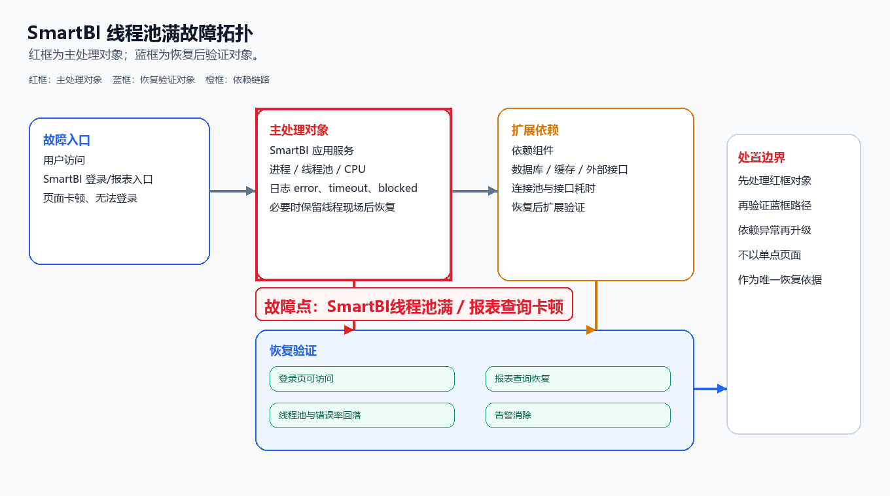

# SmartBI - 线程池满 故障处置手册

> **故障分类**: 其他 | **所属域**: 经分域 | **首次发生**: 2026-03-18 | **累计次数**: 2次
>
> **最后更新**: 2026-03-27 | **数据来源**: 多域系统故障记录表
>
> **适用场景**: 线程池满 / SmartBI 页面、接口或任务异常
>
> **处置目标**: 确认 线程池满 的主故障对象，完成恢复动作和业务验证。

---

## 故障拓扑



图中标注对象为 SmartBI 在 线程池满 场景下的主处理对象和恢复验证对象。处置时先确认主故障点，再扩展到依赖链路和业务验证，避免只根据单个告警对象做局部处理。

关键对象：

- SmartBI 应用节点：确认服务进程、端口、日志和页面状态。
- 依赖组件：结合故障现象检查数据库、中间件、缓存或外部接口。
- 业务验证入口：恢复后验证页面、接口、后台任务和日志链路。

## 故障点标注与恢复对象

红框为本次故障优先处理点；恢复后再按蓝框/依赖链路完成验证。

| 标注 | 故障点/现象 | 优先恢复动作 | 需要重启/执行的服务 |
|---|---|---|---|
| 红框 | SmartBI 应用服务线程池、CPU 或连续 timeout/blocked | 保留线程现场后恢复应用服务 | SmartBI 应用/Web 服务，现场脚本为准 |
| 橙框 | 数据库、缓存、外部接口耗时 | 服务恢复后扩展验证依赖耗时 | 依赖侧只在确认异常时恢复 |

> 说明：如果现场服务名、脚本路径与表内名称不一致，以生产主机实际部署和变更审批为准；依赖类故障先恢复依赖，再决定是否重启应用。

## 适用范围与故障判定

### 适用范围

遇到以下任一现象，进入本手册流程处理：

- SmartBI系统卡顿
- SmartBI无法登录
- SmartBI 页面或接口响应缓慢、无响应，伴随线程池耗尽或任务堆积。
- 进程仍存在但请求持续超时，日志出现 blocked、pool、timeout 等关键字。
- 恢复后必须确认线程、连接池和业务入口都恢复正常。

### 判定规则

| 如果看到 | 先做什么 | 判断结论 |
|----------|----------|----------|
| 页面或接口不可用 | 确认进程、端口和最近日志 | 先收敛到应用侧还是依赖侧 |
| 进程存在但页面打不开或请求超时 | 记录 PID，必要时保留线程现场，再 kill 旧进程并重启 | 按服务假活处理，不能只看进程存活 |
| 恢复后仍有告警 | 回查页面、接口、日志和监控 | 确认是否是假恢复或依赖未恢复 |

## 标准处置流程

1. 记录告警时间、故障入口、受影响业务和当前监控状态。
2. 确认服务进程、端口监听、资源水位和最近日志关键字。
3. 按故障边界通知运维、厂商、开发或 DBA 介入处理。
4. 执行恢复动作后回查页面、接口、任务和日志。
5. 若短时间复发，保留现场并升级根因分析，不只重复重启。

## 关键检查命令

以下命令已按本故障场景去重整理；每条命令先说明用途，执行前按实际主机、路径、权限和变更流程确认。

### 查看相关进程

确认相关服务进程是否存活、是否存在重复或僵死进程。

```bash
ps -ef | grep -Ei "smartbi" | grep -v grep
```
### 查看服务状态

若服务由 systemd 管理，可直接确认当前状态与最近报错。

```bash
systemctl status smartbi --no-pager
```
### 查看最近日志

先看近 200 行日志，快速确认报错关键字与时间点。

```bash
tail -n 200 /var/log/smartbi.log
```
### 查看系统资源快照

先建立现场快照，便于判断是服务问题还是环境问题。

```bash
uptime && free -h && df -h
```
### 检查关键日志关键字

按实际日志路径替换，快速搜集错误、超时、异常退出信息。

```bash
grep -Ei "error|exception|timeout|oom|fail" /var/log/smartbi.log | tail -n 50
```

## 协同分工与通知口径

### 通知口径

> SmartBI 出现 线程池满，当前已按手册确认故障对象为 SmartBI 应用节点。请对应责任团队优先处理主故障点，运维侧同步保留现场并完成页面、接口、任务和监控恢复验证。

### 谁负责什么

| 角色 | 负责范围 | 处置动作 |
|------|----------|----------|
| 一线运维 | 告警确认、现场操作、恢复验证 | 执行标准处置流程并记录结果 |
| 系统维护 / 厂商 | 应用服务、脚本、配置和程序逻辑 | 恢复服务并定位反复故障根因 |
| DBA / 平台支撑 | 数据库、中间件、主机和网络依赖 | 在扩展验证异常时介入处理 |

## 恢复验证清单

完成恢复动作后，按以下顺序验证：

1. SmartBI 关键页面或入口可正常访问。
2. 相关告警已消除或回落到正常阈值。
3. 最近日志不再持续出现同类错误关键字。
4. 服务进程、端口和核心接口均恢复正常。
5. 恢复后至少完成一次关键业务路径验证。

## 根因与预防

### 根因判断

- 直接根因：SmartBI 应用服务出现进程假死、线程池耗尽或认证链路异常。
- 应用表现：页面不可用、登录失败、请求超时或监控告警入口异常。
- 处置边界：先恢复主处理服务，再扩展检查磐基、数据库或其他依赖。

### 长期预防

- 增加进程存活、线程池、响应时间和错误率监控。
- 固化标准恢复顺序和恢复后业务验证清单。
- 对短时间复发问题升级开发或厂商做代码级根因修复。

## 历史案例

| 序号 | 发生时间 | 故障现象 | 恢复手段 | 故障原因 | 处理时长 |
|------|----------|----------|----------|----------|----------|
| 31 | 2026-03-18 14:58 | SmartBI系统卡顿 | 重启后台程序 | 线程数过高 | 7min |
| 26 | 2026-03-27 16:27 | SmartBI无法登录 | 重启后台程序 | 线程数过高 | 12min |
