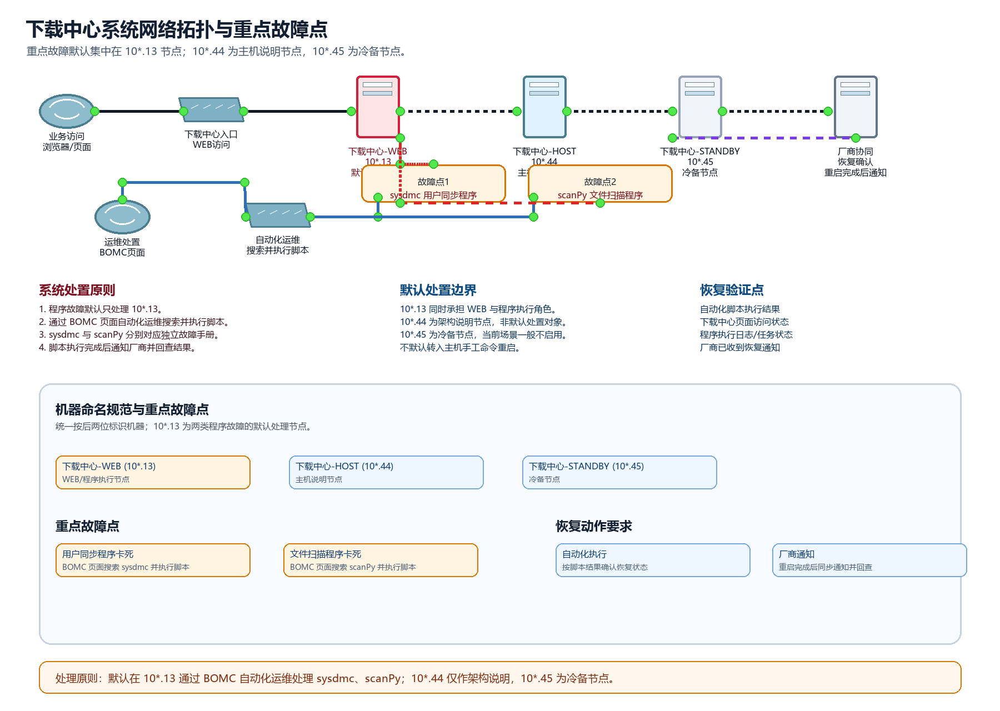

# 下载中心 运维总览与故障处理索引

> **所属域**: 经分域 | **累计故障**: 5次 | **指引数量**: 2篇

## 系统概览

下载中心当前高频故障集中在 10.253.43.13 ftp / 程序执行节点，用户同步程序 sysdmc 和文件扫描程序 scanPy 均通过 BOMC 自动化预案触发恢复。

- 服务范围：覆盖下载中心 10.253.43.13 程序执行节点、10.253.43.44-45 前台应用主备与 10.252.149.105/107 数据库验证链路。

### 处理原则

1. 程序故障默认只处理 10.253.43.13 节点，不默认扩展到 10.253.43.44-45。
2. 用户同步程序和文件扫描程序应拆分为独立故障指引，但共享同一系统拓扑和机器命名规范。
3. BOMC 自动化预案执行完成后，需要同步通知厂商并回查页面、日志和任务结果。

## 网络拓扑

> 基于原始下载中心拓扑图标注 10.253.43.13 处理节点、10.253.43.44-45 前台验证对象和 10.252.149.105/107 数据库验证链路。

## 机器命名规范

统一按机器后两位标识处理节点；13 为 ftp / 程序执行节点，44-45 为前台应用主备，日常程序故障不作为默认处置对象。

| IP标识 | 规范名称 | 节点说明 | 处理提醒 |
|--------|----------|----------|----------|
| 10*.13 | 下载中心-FTP/程序执行节点 | ftp / 程序执行节点 | sysdmc、scanPy 默认通过 BOMC 自动化预案处理。 |
| 10*.44-45 | 下载中心-前台应用主备 | 前台应用 | 恢复后验证对象，当前两类程序故障一般不作为默认处理机器。 |
| DB | 下载中心-数据库 | 数据库依赖 | 预案成功后仍异常再扩展验证。 |

## 重点故障点与处置边界

| 故障类型 | 重点位置 | 处置边界 | 验证要求 |
|----------|----------|----------|----------|
| 用户同步程序卡死 | 10.253.43.13 / sysdmc | 在 BOMC 自动化预案中搜索 sysdmc 并执行恢复预案，不在主机侧手工重启。 | 验证预案结果、同步任务恢复和厂商通知完成。 |
| 文件扫描程序卡死 | 10.253.43.13 / scanPy | 在 BOMC 自动化预案中搜索 scanPy 并执行恢复预案，不默认处理 10.253.43.44-45。 | 验证扫描任务恢复、页面可用性和相关日志正常。 |

## 角色分工

### 运维
- 负责范围：BOMC 自动化预案执行、结果验证
- 处置动作：
  1. 在 BOMC 自动化预案中搜索对应程序恢复预案。
  2. 执行恢复预案后回查页面、任务状态和日志。
  3. 完成后通知厂商并确认结果。

### 厂商
- 负责范围：程序恢复确认与后续问题跟踪
- 处置动作：
  1. 接收重启完成通知并协助确认业务恢复。
  2. 若预案执行后程序仍不稳定，配合定位程序逻辑问题。
  3. 沉淀程序异常的后续优化方案。

### 开发
- 负责范围：程序稳定性和自动化预案优化
- 处置动作：
  1. 定位 sysdmc、scanPy 反复卡死的触发条件。
  2. 完善程序监控、日志关键字和自动恢复能力。
  3. 优化自动化预案返回值与失败告警机制。

## 运维提醒

- 下载中心适合继续保持“系统总览一页 + 两个故障手册分开”的结构。
- 若后续补齐更多主机信息，可把 10*.44、10*.45 的职责进一步细化到机器命名表。

## 指引列表

| 序号 | 故障模式 | 分类 | 发生次数 | 最近发生 |
|------|----------|------|----------|----------|
| 1 | 文件扫描程序卡死 | 应用 | 2 | 2026-06-03 |
| 2 | 用户同步程序卡死 | 应用 | 1 | 2026-05-11 |

## 本月高频关注

- 文件扫描程序卡死：累计 2 次，最近发生于 2026-06-03
- 用户同步程序卡死：累计 1 次，最近发生于 2026-05-11
