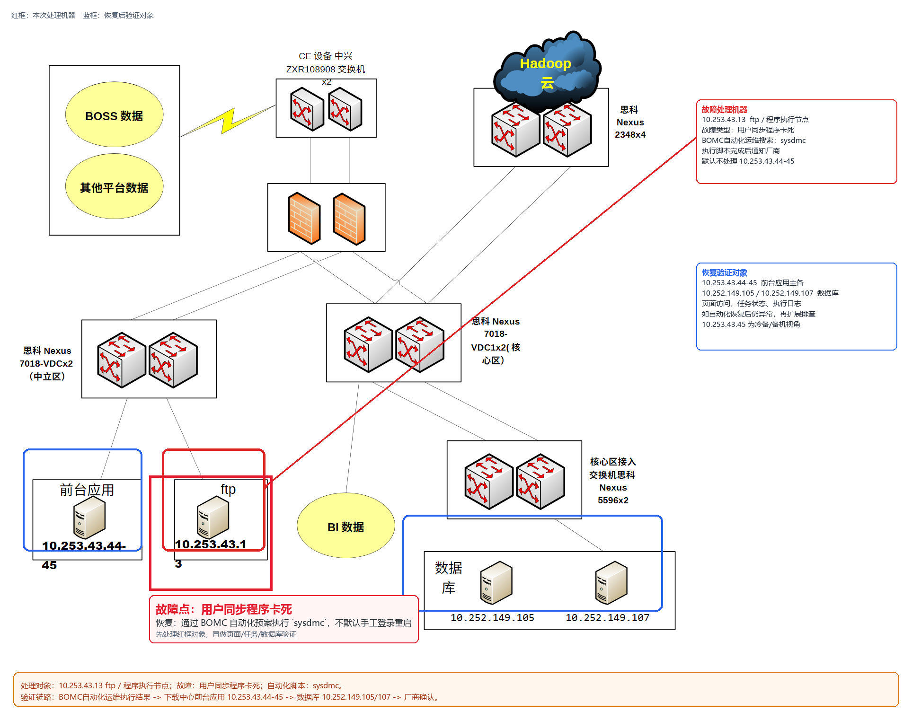

# 下载中心 - 用户同步程序卡死 故障处置手册

> **故障分类**: 应用 | **所属域**: 经分域 | **首次发生**: - | **累计次数**: 1次
>
> **最后更新**: 2026-05-11 | **数据来源**: 多域系统故障记录表
>
> **适用场景**: 用户同步程序卡死 / 同步任务积压 / 下载中心用户数据同步异常
>
> **处置目标**: 在拓扑中快速定位 `10.253.43.13` 程序执行节点，通过 BOMC 自动化预案执行 `sysdmc` 恢复，并完成页面、任务、数据库和厂商确认

---

## 故障拓扑



图中标注对象为 下载中心 在 用户同步程序卡死 场景下的主处理对象和恢复验证对象。处置时先确认主故障点，再扩展到依赖链路和业务验证，避免只根据单个告警对象做局部处理。

关键对象：

- 10.253.43.13：ftp / 程序执行节点，默认通过 BOMC 自动化预案执行 sysdmc 恢复。
- 10.253.43.44-45：前台应用主备，恢复后验证页面和任务入口。
- 10.252.149.105 / 10.252.149.107：数据库依赖，验证任务状态回写和结果落库。
- 用户同步任务：恢复后必须确认积压任务继续推进，不只验证页面可访问。

## 故障点标注与恢复对象

红框为本次故障优先处理点；恢复后再按蓝框/依赖链路完成验证。

| 标注 | 故障点/现象 | 优先恢复动作 | 需要重启/执行的服务 |
|---|---|---|---|
| 红框 | 10.253.43.13 ftp/程序执行节点上用户同步程序卡死 | 进入 BOMC 自动化预案执行恢复 | `sysdmc` 自动化预案 |
| 蓝框 | 前台应用、数据库和厂商结果确认 | 预案成功后验证同步任务推进、结果落库和页面状态 | 一般不重启 10.253.43.44-45，除非验证发现前台异常 |

> 说明：如果现场服务名、脚本路径与表内名称不一致，以生产主机实际部署和变更审批为准；依赖类故障先恢复依赖，再决定是否重启应用。

## 适用范围与故障判定

### 适用范围

遇到以下任一现象，进入本手册流程处理：

- 亚信修改数据库沉默账号冻结sql
- 下载中心用户同步任务长时间不结束，同步队列持续积压。
- 页面或结果回写明显延迟，优先定位 10.253.43.13 上的 sysdmc。
- BOMC 自动化预案执行后仍异常时，升级厂商确认补同步结果。

### 判定规则

| 如果看到 | 先做什么 | 判断结论 |
|----------|----------|----------|
| 页面可访问但任务不推进 | 在 BOMC 自动化预案中搜索 sysdmc | 优先按程序卡死处理 |
| 预案执行成功但结果仍不更新 | 保留执行结果并通知厂商 | 进入程序逻辑或数据补处理 |
| 前台或数据库也异常 | 扩展验证前台主备和数据库 | 确认是否存在依赖链路问题 |

## 标准处置流程

1. 确认故障是否属于用户同步任务不推进，记录发现时间和积压范围。
2. 登录 BOMC 页面，进入自动化预案并搜索 sysdmc。
3. 执行对应自动化预案，等待任务返回成功。
4. 回查下载中心页面、用户同步任务状态和执行结果。
5. 通知厂商预案已执行完成，并要求厂商确认后续处理结果。
6. 如仍异常，保留预案结果、页面截图和任务状态后升级厂商分析。

## 关键检查命令

以下命令已按本故障场景去重整理；每条命令先说明用途，执行前按实际主机、路径、权限和变更流程确认。

### 执行 sysdmc 自动化预案

默认通过 BOMC 自动化预案执行，不优先登录主机手工重启；执行完成后保存预案返回结果。

```text
BOMC页面 -> 自动化预案 -> 搜索 sysdmc -> 执行恢复预案 -> 保存执行结果
```
### 确认 用户同步 任务是否推进

用于恢复后确认积压任务开始下降，避免只看页面可访问就关闭故障。

```text
登录下载中心页面 -> 查看用户同步任务状态 -> 记录积压数量和最新处理时间
```
### 补充检查程序执行节点

只有 BOMC 自动化预案失败、返回异常或厂商要求时再登录 10.253.43.13，确认程序是否仍假活。

```bash
ps -ef | grep -Ei "scanPy|sysdmc" | grep -v grep
top -b -n 1 | head -n 30
```
### 补充检查执行日志

用于确认预案执行后是否仍有连续失败、漏扫、同步失败或结果回写异常。

```bash
grep -Ei "error|exception|timeout|fail|scan|sync" <下载中心日志目录>/*.log | tail -n 100
```

## 协同分工与通知口径

### 通知口径

> 下载中心 出现 用户同步程序卡死，当前已按手册确认故障对象为 10.253.43.13。请对应责任团队优先处理主故障点，运维侧同步保留现场并完成页面、接口、任务和监控恢复验证。

### 谁负责什么

| 角色 | 负责范围 | 处置动作 |
|------|----------|----------|
| 一线运维 | 告警确认、现场操作、恢复验证 | 执行标准处置流程并记录结果 |
| 系统维护 / 厂商 | 应用服务、脚本、配置和程序逻辑 | 恢复服务并定位反复故障根因 |
| DBA / 平台支撑 | 数据库、中间件、主机和网络依赖 | 在扩展验证异常时介入处理 |

## 恢复验证清单

完成恢复动作后，按以下顺序验证：

1. BOMC 自动化预案执行成功并有明确返回结果。
2. 用户同步任务开始推进，积压任务逐步下降。
3. 数据库状态回写或结果落库正常。
4. 厂商已确认后续扫描/同步结果无异常。
5. 页面、任务、数据库和厂商确认均完成后再关闭故障。

## 根因与预防

### 根因判断

- 直接根因：sysdmc 程序卡死，导致任务不推进或结果回写延迟。
- 应用表现：页面可访问但任务状态、扫描结果或同步结果不更新。
- 处置边界：默认通过 BOMC 自动化预案处理 10.253.43.13，不先扩大到前台主备或数据库故障。

### 长期预防

- 监控任务积压量、程序运行时长、失败次数和结果回写状态。
- 将 sysdmc 自动化预案纳入标准应急流程并定期验证。
- 与厂商明确补扫、补同步和回归验证闭环。

## 历史案例

| 序号 | 发生时间 | 故障现象 | 恢复手段 | 故障原因 | 处理时长 |
|------|----------|----------|----------|----------|----------|
| 归并记录 | 2026-05-11 | 亚信修改数据库沉默账号冻结sql | 联系厂商回退 | 应用 | - |
