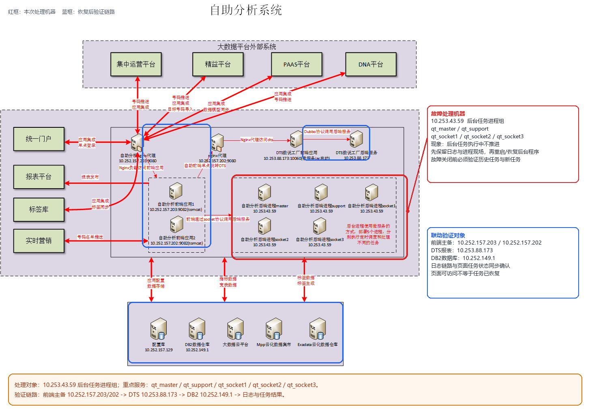

# 自助分析 运维总览与故障处理索引

> **所属域**: 经分域 | **累计故障**: 11次 | **指引数量**: 1篇

## 系统概览

自助分析的高频故障集中在后台任务调度与跑数服务卡住，问题通常表现为任务长时间停留在执行中，页面可访问但结果迟迟不返回；恢复动作通过 BOMC 自动化预案执行。

- 服务范围：覆盖页面入口、后台调度进程、任务队列以及数据库、缓存、文件目录等依赖链路。

### 处理原则

1. 跑数服务恢复通过 BOMC 自动化预案执行，不默认登录主机手工重启后台程序。
2. 恢复动作完成后必须同时验证历史卡住任务和新提交任务，不接受只恢复表面可用性。
3. 若同日连续复发，应升级为代码或依赖专项问题，不再只以重启结项。

## 网络拓扑

> 红框为当前需处理的 10.253.43.59 后台任务进程组，蓝框为前端主备、DTS、DB2 与日志链路联动验证区。

## 重点故障点与处置边界

| 故障类型 | 重点位置 | 处置边界 | 验证要求 |
|----------|----------|----------|----------|
| 后台任务进程卡住 | BOMC 自动化预案 / 10.253.43.59 | 通过 BOMC 自动化预案重启自助分析跑数服务；主机侧进程检查只作为预案失败后的补充动作。 | 验证预案执行成功、历史卡住任务继续推进、新任务可正常完成、日志无持续阻塞。 |

## 角色分工

### 运维
- 负责范围：BOMC 自动化预案、页面、任务状态、日志与依赖检查
- 处置动作：
  1. 确认是单任务卡死还是整个调度进程卡死。
  2. 通过 BOMC 自动化预案执行跑数服务重启。
  3. 恢复后验证历史任务与新任务都可继续执行。

### DBA
- 负责范围：数据库锁等待、慢 SQL 与连接问题
- 处置动作：
  1. 配合确认是否存在锁等待、慢 SQL 或连接阻塞。
  2. 回查任务落库、回写和事务状态。
  3. 协助排除数据库侧引起的任务卡死。

### 开发
- 负责范围：调度逻辑、线程池、重试与幂等控制
- 处置动作：
  1. 定位任务卡死的代码路径、重试逻辑和队列阻塞根因。
  2. 完善超时中断、失败重试上限和僵死任务清理机制。
  3. 推动任务链路监控和自动恢复能力建设。

## 运维提醒

- 自助分析建议补充任务 ID、任务类型、依赖资源三个维度的现场信息模板。
- 自助分析跑数服务重启入口统一放在 BOMC 自动化预案，主机侧处理只作为预案失败后的补充排查。
- 后续若补齐主机命名与部署信息，可继续把拓扑从功能视图升级为网络视图。

## 指引列表

| 序号 | 故障模式 | 分类 | 发生次数 | 最近发生 |
|------|----------|------|----------|----------|
| 1 | 后台任务进程卡住 | 应用 | 10 | 2026-05-06 |

## 本月高频关注

- 后台任务进程卡住：累计 10 次，最近发生于 2026-05-06
