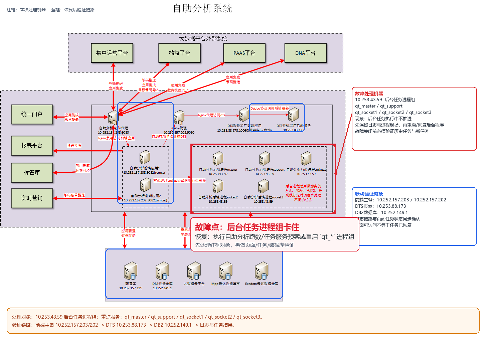

# 自助分析 - 后台任务进程卡住 故障处置手册

> **故障分类**: 应用 | **所属域**: 经分域 | **首次发生**: 2026-03-19 | **累计次数**: 10次
>
> **最后更新**: 2026-05-06 | **数据来源**: 多域系统故障记录表
>
> **适用场景**: 后台跑数任务卡住 / 任务队列不推进 / 页面可访问但结果不返回
>
> **处置目标**: 通过 BOMC 自动化预案重启自助分析跑数服务，恢复任务推进，并同步验证前端、DTS、DB2 与日志链路

---

## 故障拓扑



图中标注对象为 自助分析 在 后台任务进程卡住 场景下的主处理对象和恢复验证对象。处置时先确认主故障点，再扩展到依赖链路和业务验证，避免只根据单个告警对象做局部处理。

关键对象：

- BOMC 自动化预案：自助分析跑数服务重启的主恢复入口。
- 10.253.43.59：后台任务处理机，预案失败或厂商要求时再做主机侧补充检查。
- qt_master / qt_support / qt_socket*：后台任务调度与队列处理进程，不作为默认手工重启入口。
- 10.252.157.203 / 10.252.157.202：前端主备，恢复后验证页面与任务提交。
- 10.253.88.173 / 10.252.149.1：DTS 报表与 DB2 依赖，恢复后做联动验证。

## 故障点标注与恢复对象

红框为本次故障优先处理点；恢复后再按蓝框/依赖链路完成验证。

| 标注 | 故障点/现象 | 优先恢复动作 | 需要重启/执行的服务 |
|---|---|---|---|
| 红框 | 10.253.43.59 后台任务进程组不推进 | 先保留日志和进程现场，再执行自动化预案或恢复后台任务 | `qt_master`、`qt_support`、`qt_socket1`、`qt_socket2`、`qt_socket3` |
| 蓝框 | 前端主备、DTS、DB2 和日志结果 | 恢复后验证任务推进、页面状态和数据库回写 | 依赖侧只在确认异常时恢复 |

> 说明：如果现场服务名、脚本路径与表内名称不一致，以生产主机实际部署和变更审批为准；依赖类故障先恢复依赖，再决定是否重启应用。

## 适用范围与故障判定

### 适用范围

遇到以下任一现象，进入本手册流程处理：

- 后台跑数任务夯死无法操作
- 后台跑数任务长时间停留在执行中，页面可访问但结果不返回。
- 页面可访问但跑数任务长时间停留在执行中，需通过 BOMC 自动化预案重启跑数服务。
- 同日连续复发时，升级调度进程、代码逻辑或依赖链路专项排查。

### 判定规则

| 如果看到 | 先做什么 | 判断结论 |
|----------|----------|----------|
| 单个任务长时间执行中 | 记录任务 ID 并确认是否需要执行跑数服务预案 | 优先按单任务卡死处理 |
| 多批任务均不推进 | 在 BOMC 自动化预案中执行跑数服务重启 | 按调度进程整体异常处理 |
| 恢复后旧任务仍卡住 | 验证历史任务和新任务 | 不能按页面可访问直接结项 |

## 标准处置流程

1. 记录任务 ID、任务类型、提交时间、故障发现时间和影响入口。
2. 登录 BOMC 页面，进入自动化预案，选择自助分析跑数服务重启预案。
3. 执行预案并保存返回结果，记录预案开始时间、结束时间和执行状态。
4. 回查自助分析页面、历史卡住任务和新提交任务是否恢复推进。
5. 只有预案执行失败、返回异常或厂商要求时，才登录 10.253.43.59 补充检查进程、资源和日志。
6. 恢复后同时验证历史任务、新任务、前端、DTS、DB2 和日志链路。

## 关键检查命令

以下命令已按本故障场景去重整理；每条命令先说明用途，执行前按实际主机、路径、权限和变更流程确认。

### 执行跑数服务自动化预案

跑数服务恢复通过 BOMC 自动化预案执行，不默认登录主机手工重启；执行完成后保存预案返回结果。

```text
BOMC页面 -> 自动化预案 -> 搜索 自助分析跑数服务 -> 执行重启预案 -> 保存执行结果
```
### 确认跑数任务是否推进

用于恢复后确认历史卡住任务继续推进，并验证新提交任务可以正常完成。

```text
登录自助分析页面 -> 查看历史卡住任务状态 -> 新提交一笔验证任务 -> 记录任务结果和耗时
```
### 补充检查后台任务进程

只有 BOMC 自动化预案执行失败、返回异常或厂商要求时再登录 10.253.43.59，确认 qt_master / qt_support / qt_socket 是否仍假活。

```bash
ps -ef | grep -Ei "qt_master|qt_support|qt_socket" | grep -v grep
```
### 保留主机资源现场

用于预案失败后的补充判断，确认是否存在 CPU、内存、IO 或系统资源异常。

```bash
top -b -n 1 | head -n 30
free -h
df -h
```
### 按任务 ID 回查日志

用于定位具体卡住任务、队列阻塞点、重复重试或依赖超时，<task_id> 按现场替换。

```bash
grep -Ei "<task_id>|qt_master|qt_support|qt_socket|timeout|deadlock|queue" <自助分析日志目录>/*.log | tail -n 120
```
### 检查数据库锁等待

任务恢复后仍无法完成时由 DBA 执行，重点确认任务状态回写、锁等待和慢 SQL。

```bash
db2 connect to <db_name>
db2 list applications
db2pd -db <db_name> -locks
```

## 协同分工与通知口径

### 通知口径

> 自助分析 出现 后台任务进程卡住，当前已按手册确认故障对象为 BOMC 自动化预案。请对应责任团队优先处理主故障点，运维侧同步保留现场并完成页面、接口、任务和监控恢复验证。

### 谁负责什么

| 角色 | 负责范围 | 处置动作 |
|------|----------|----------|
| 一线运维 | 告警确认、现场操作、恢复验证 | 执行标准处置流程并记录结果 |
| 系统维护 / 厂商 | 应用服务、脚本、配置和程序逻辑 | 恢复服务并定位反复故障根因 |
| DBA / 平台支撑 | 数据库、中间件、主机和网络依赖 | 在扩展验证异常时介入处理 |

## 恢复验证清单

完成恢复动作后，按以下顺序验证：

1. BOMC 自动化预案执行成功并有明确返回结果。
2. 历史卡住任务继续推进并产生成功或明确失败结果。
3. 新提交任务可以正常完成，不再停留在执行中。
4. 前端主备、DTS、DB2 和日志链路无持续异常。
5. 同类任务未在短时间内再次卡死。

## 根因与预防

### 根因判断

- 直接根因：后台任务进程组不推进，导致跑数任务长期停留在执行中。
- 应用表现：页面可访问但任务结果不返回，历史任务或新任务持续堆积。
- 处置边界：恢复动作通过 BOMC 自动化预案执行，不优先登录 10.253.43.59 手工重启后台进程组。

### 长期预防

- 监控调度心跳、任务堆积、最长执行时长和失败重试次数。
- 定期验证 BOMC 自动化预案可用性、返回值和失败告警。
- 同日多次复发时升级下游依赖和代码路径专项分析。

## 历史案例

| 序号 | 发生时间 | 故障现象 | 恢复手段 | 故障原因 | 处理时长 |
|------|----------|----------|----------|----------|----------|
| 19 | 2026-03-19 10:22 | 后台跑数任务夯死无法操作 | BOMC 自动化预案重启跑数服务 | 后台跑数任务卡住 | 8min |
| 53 | 2026-05-06 11:45 | 后台跑数任务夯死无法操作 | BOMC 自动化预案重启跑数服务 | 后台跑数任务卡住 | 2min |
